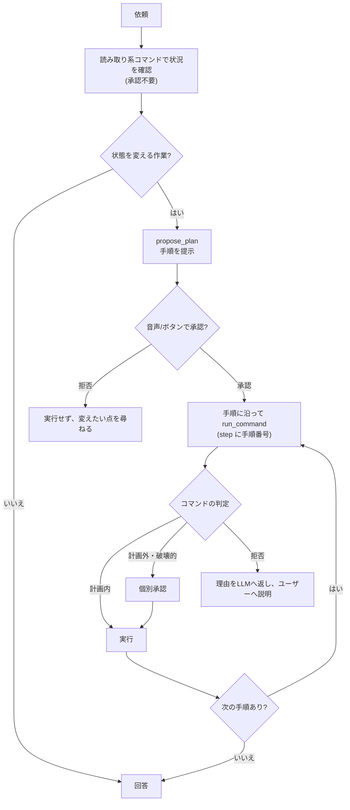

# エージェント: 作業依頼(コマンド実行)

「〜してください」という依頼に対し、LLM が手順を考え、シェルコマンドをローカルで実行しながら自律的に進める。[agent-file-tools.md](agent-file-tools.md) のツールループを拡張した機能で、**Claude(Anthropic)選択時のみ**有効。設定画面の Command Tasks で切り替える(既定は有効、キー `shell_access`)。

実装は `services/agent.rs`(`propose_plan` / `run_command`)、`services/shell.rs`(実行)、`services/command_policy.rs`(判定。[command-policy.md](command-policy.md))、フロントエンドの `ApprovalModal` / `ExecutionLog` / `lib/voiceApproval.ts`。

## 流れ

1. 読み取り系コマンドで状況を確認する(承認不要)。
2. 状態を変える作業は `propose_plan` で手順を提示する。画面中央の半透明モーダルに表示され、読み上げられる。**肯定された場合のみ**実行に進む。
3. 承認された計画の範囲内(`run_command` の `step` が計画の手順番号)のコマンドは、都度の承認なしで実行する。
4. 計画外のコマンド、破壊的になりうるコマンドは、その都度モーダルで承認を求める。
5. 左上の直前の会話の下にある実行ログに、コマンド・出力・計画の進み具合を表示する。「中断」でコマンドとループを止める。

### 計画の寿命

- 計画は**依頼ごと**に持ち、次の依頼へは引き継がない。
- 新しい計画を出すと、承認済みだった前の計画は失効し、再承認が要る。
- 計画の失効と会話の切り替えは別。作業の依頼・承認・実行では会話(セッション)は切り替わらず、進行中の会話の続きとして扱う([conversation-session.md](conversation-session.md))。

## ツール

| ツール | 入力 | 備考 |
| --- | --- | --- |
| `propose_plan` | `summary`(1 文)、`steps`(1〜20 件、各 300 文字以内) | 承認されると計画として保持する。拒否時は「どこを変えたいかをユーザーに尋ねる」よう LLM へ返す |
| `run_command` | `command`(4,000 文字以内)、`cwd`(絶対パスまたは `~/`、省略時はホーム)、`step`、`timeout_secs` | `step` は承認済み計画の手順番号(1 始まり) |

LLM 呼び出しの上限は、コマンド実行が有効なとき 1 依頼あたり 40 回(通常は 20 回)。

## 承認の種類

`approval` イベントの `kind` で区別する。

| kind | 内容 | 承認されたとき |
| --- | --- | --- |
| `plan` | 作業計画 | 計画として保持し、計画内のコマンドを都度の承認なしで実行できる |
| `command` | 計画外、または `ask` のコマンドの個別承認。理由つき | そのコマンドを実行する |
| `allow_command` | 許可リストにないコマンドを、ナレッジの外で実行する承認 | パターンを許可リストへ加えて実行する。拒否したら何も変更しない |
| `file` | `create_file` の作成 | ファイルを作成する |

`allow_command` は、読み取り系以外の許可リストにないコマンドがナレッジの外に及ぶときの手段。ユーザーが音声で承認すると、`git log` のようにサブコマンドまで含めたパターンを `command-policy.json` の `allow` に加える([command-policy.md](command-policy.md#許可リストへの追加))。

## コマンドの実行(`shell.rs`)

- `/bin/sh -c`、標準入力なし。タイムアウトは既定 60 秒、最大 600 秒(`timeout_secs`)。
- 新しいプロセスグループで起動し、時間切れ・中断時はグループごと SIGKILL する。
- 出力は逐次 `command_output` イベントで画面へ流す。LLM へは終了コードと、標準出力・標準エラーの先頭 8,000 / 末尾 4,000 文字を返す。
- 終了コードが 0 以外、時間切れ、中断は `is_error` で返す。
- 実行の前に、判定(Deny は実行しない)と、必要な承認を済ませる。

## 音声承認

承認は画面のボタンでも答えられるが、基本は音声。

- 承認要求が出たら**自動で録音を始め**、発話後 1.2 秒の無音で文字起こしして判定する(録音の開始に約 2 秒かかる)。スペースキーの長押しでも答えられる。
- 判定は単語表(`lib/voiceApproval.ts`)で行い、LLM には判定させない。否定語を含めば否定、肯定語のみなら肯定、それ以外は聞き直す。30 文字を超える発話は返答として扱わない。詳細は [conversation-session.md](conversation-session.md#肯定否定の判定voiceapprovalts)。
- 承認の待ち時間は 120 秒。超えたら拒否として扱う。

## 中断(`agent_cancel`)

- 実行中の依頼は同時に 1 つだけ。`CancelToken`(複製して共有でき、どれか 1 つが `cancel` すれば全員に伝わる)で、LLM 待ち・コマンド実行・承認待ちのどれも中断できる。
- 動いているコマンドは強制終了し、承認待ちは拒否として扱い、履歴を呼び出し前に戻して「作業を中断しました。」を返す。

## システムプロンプトでの指示(`shell_guide`)

- 環境(macOS、ホームのパス、`/bin/sh -c`、cwd の既定はホーム)を伝える。
- 作業は読み取り系で状況を確かめてから進め、推測で進めない。曖昧なら計画の前に一つずつ聞き返す。
- 状態を変える作業は先に `propose_plan`。拒否されたコマンドは理由を伝えて別の方法を相談する。
- 許可リストにない状態を変えるコマンドをナレッジの外で実行するときは、許可に加えてよいかをユーザーに確認する。
- 作業の依頼は進行中の会話の続きとして扱い、会話の切り替えやクリアを提案しない。
- API キーや認証情報を読み取らない。最終回答は、何をしてどうなったかを短く。

## 既知の限界

- 判定は構文解析による**静的な検査**。`python -c` や `perl -e` の中身、変数展開で組み立てたコマンドの中身までは見ない。それらは計画の承認と、個別承認(`ask`)に頼る。
- 実行範囲は、読み取り系(Auto)を除きナレッジのディレクトリ内に限る(決定事項)。守りは、判定ルール・範囲の検査・承認・タイムアウト・中断。
- 実行ログは対話画面にのみ表示される。別画面へ移ると表示は消えるが、実行は続く。
- ツール対応は Anthropic のみ。
