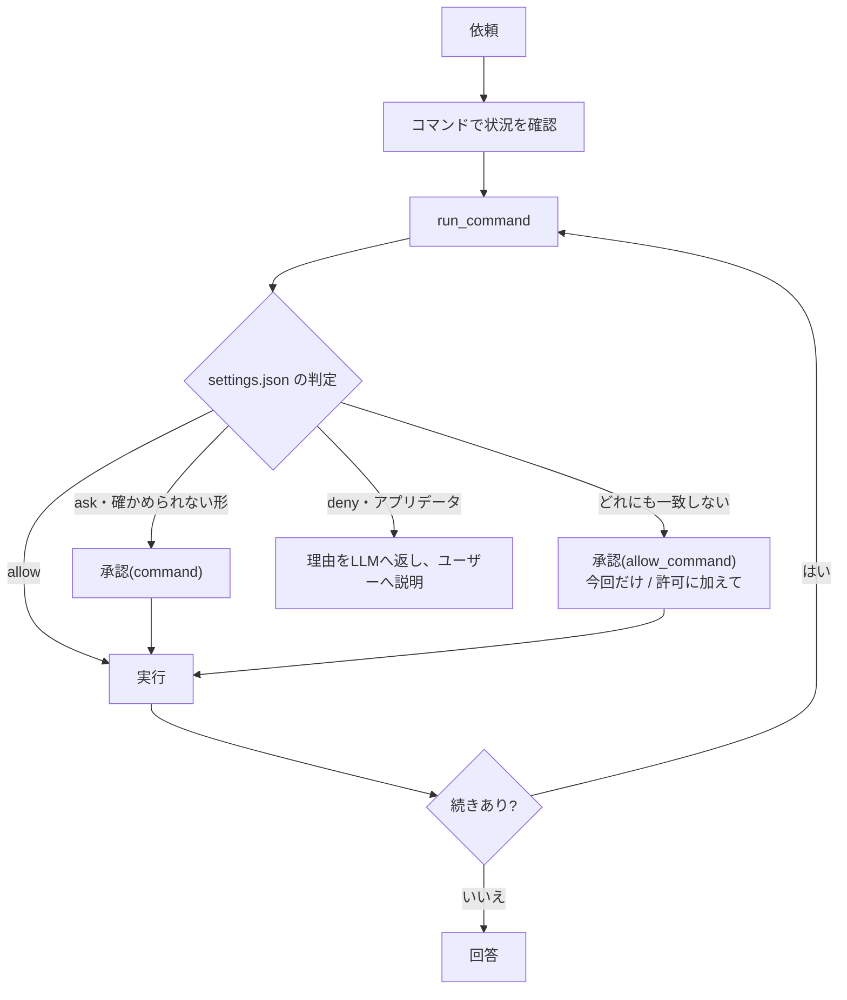

# エージェント: 作業依頼(コマンド実行)

「〜してください」という依頼に対し、LLM が手順を考え、シェルコマンドをローカルで実行しながら自律的に進める。[agent-file-tools.md](agent-file-tools.md) のツールループを拡張した機能で、**API 方式で Anthropic または端末内のモデルを選んだとき**に有効(Bedrock 方式・ワークのエージェントは、端末内のモデルも選べず、コンテナ内の Claude Code が自身のツールで実行する)。オン・オフのスイッチは無く、常に有効。可否は、API 方式では権限タブの settings.json([api-permissions.md](api-permissions.md))、コンテナ内の Claude Code では Sandbox タブの settings.json の `permissions` で決める(以前の設定キー `shell_access` は使わない。DB に残っていても読まない)。

実装は `services/tool_loop.rs`(`run_command`)、`services/shell.rs`(実行)、`services/permissions.rs`(判定。[api-permissions.md](api-permissions.md))、フロントエンドの `ApprovalModal` / `ExecutionLog` / `lib/voiceApproval.ts`。

## 流れ

1. LLM はコマンドで状況を確かめ、状態を変える作業は、実行する前に何をするかを短く伝える。
2. `run_command` のたびに settings.json の `permissions` で判定する([api-permissions.md](api-permissions.md))。`allow` に一致するものは承認なしで実行する。
3. `ask` に一致するもの、内容を確かめられない形(`sh -c`、リダイレクト、変数の引数など)は、毎回モーダルで承認を求める。
4. どのルールにも一致しないものは、「今回だけ実行」か「許可に加えて実行」を選ぶ承認を求める。
5. 会話のスレッドの発話の下にある実行ログ(`TurnLog` / `ExecutionLog`)に、コマンドと出力を表示する。「中断」(または `Esc`)でコマンドとループを止める。

作業の依頼・承認・実行では会話(セッション)は切り替わらず、進行中の会話の続きとして扱う([conversation-session.md](conversation-session.md))。

以前あった作業計画(`propose_plan`。承認した計画の手順は都度の承認なしで実行できた)は廃止した。保存済みの実行ログに残る計画は、そのまま表示する。

## ツール

| ツール | 入力 | 備考 |
| --- | --- | --- |
| `run_command` | `command`(4,000 文字以内)、`cwd`(絶対パスまたは `~/`、省略時はホーム)、`timeout_secs` | 判定と必要な承認を済ませてから実行する |

LLM 呼び出しの上限は、コマンド実行が有効なとき 1 依頼あたり 40 回(通常は 20 回)。

## 承認の種類

`approval` イベントの `kind` で区別する。

| kind | 内容 | 承認されたとき |
| --- | --- | --- |
| `command` | `ask` に一致した、または内容を確かめられないコマンドの承認。理由つき | そのコマンドを実行する |
| `allow_command` | どのルールにも一致しないコマンドの承認 | 「今回だけ実行」ならそのまま実行する。「許可に加えて実行」なら `Bash(<パターン>:*)` を `permissions.allow` へ加えて実行する。拒否したら何も変更しない |
| `file` | `create_file` の作成 | ファイルを作成する |
| `file_overwrite` | `create_file` の資料(`data/reports/`)の上書き(`overwrite: true`) | 資料を新しい内容で置き換える |

`command` と `allow_command` は、**画面のボタンでだけ承認できる**(周囲の音声や聞き間違いで、破壊的なコマンドや恒久的な許可が通らないようにする。音声の「いいえ」での拒否はできる)。`file`・`file_overwrite`・スキルの更新と削除は、音声でも承認できる。

`allow_command` のパターンは、`git log` のようにサブコマンドまで含める([api-permissions.md](api-permissions.md#許可への追加))。

## コマンドの実行(`shell.rs`)

- `/bin/sh -c`、標準入力なし。タイムアウトは既定 60 秒、最大 600 秒(`timeout_secs`)。
- 新しいプロセスグループで起動し、時間切れ・中断時はグループごと SIGKILL する。
- 出力は逐次 `command_output` イベントで画面へ流す。LLM へは終了コードと、標準出力・標準エラーの先頭 8,000 / 末尾 4,000 文字を返す。
- 終了コードが 0 以外、時間切れ、中断は `is_error` で返す。
- 実行の前に、判定(Deny は実行しない)と、必要な承認を済ませる。
- コンテナで動くエージェント(ワークは常に。パーソナルは Bedrock 方式のとき)では、このツールループ自体を使わず、会話はコンテナ内の Claude Code が受け持つ。コマンドもコンテナ内の Claude Code が実行する。詳細は [sandbox.md](sandbox.md)。
- ツールループの `run_command` をコンテナで実行する仕組み(`services/sandbox.rs`。cwd を `/knowledge` 配下へ変換し、タイムアウト・中断はコンテナ内のプロセスグループごと止める)は残っているが、会話からは使われない([sandbox.md](sandbox.md) の後回しの項目 18)。

## 音声承認

ファイル作成・スキルの変更の承認は、画面のボタンでも答えられるが、基本は音声(コマンドの承認と許可への追加はボタンのみ)。

- 承認要求が出たら**自動で録音を始め**、発話後 1.2 秒の無音で文字起こしして判定する(録音の開始に約 2 秒かかる)。エージェントキーの長押しでも答えられる。
- 判定は単語表(`lib/voiceApproval.ts`)で行い、LLM には判定させない。否定語・否定の形(「許可しない」「実行しません」)を含めば否定、肯定語のみなら肯定、それ以外は聞き直す。30 文字を超える発話は返答として扱わない。詳細は [conversation-session.md](conversation-session.md#肯定否定の判定voiceapprovalts)。
- 承認の待ち時間は 120 秒。超えたら拒否として扱う。数えるのは、そのワークスペースを選んでいる間だけ(ほかのワークスペースにいる間は止まり、戻れば残りの時間で続く)。ワークスペースを切り替えても依頼は止まらず、承認は回答を待つ([workspace.md](workspace.md))。

## 中断(`task_cancel`)

- 実行中の依頼はワークスペースごとに同時に 1 つだけ。実行中に届いた `send_chat` は `busy` エラーで断る(リーダーからの配布も同じ)。`CancelToken`(複製して共有でき、どれか 1 つが `cancel` すれば全員に伝わる)で、LLM 待ち・コマンド実行・承認待ちのどれも中断できる。
- 動いているコマンドは強制終了し、承認待ちは拒否として扱い、履歴を呼び出し前に戻して「作業を中断しました。」を返す。

## システムプロンプトでの指示(`shell_guide`)

- 環境(macOS、ホームのパス、`/bin/sh -c`、cwd の既定はホーム)を伝える。
- 設定の許可に一致するコマンドは承認なしで、それ以外は承認を経て実行され、拒否に一致するものは実行できないことを伝える。
- 作業は読み取り系で状況を確かめてから進め、推測で進めない。曖昧なら実行の前に一つずつ聞き返す。
- 状態を変える作業は、実行する前に何をするかを短く伝える。拒否・不承認のときは理由を伝えて別の方法を相談する。
- 作業の依頼は進行中の会話の続きとして扱い、会話の切り替えやクリアを提案しない。
- API キーや認証情報を読み取らない。最終回答は、何をしてどうなったかを短く。

## 既知の限界

- 判定は構文解析による**静的な検査**。`python -c` や `perl -e` の中身、変数展開で組み立てたコマンドの中身までは見ない。それらは許可に加えない限り、毎回の承認に頼る。
- 実行範囲の制限(以前のナレッジ内への限定)は無い。守りは、settings.json のルール・アプリデータの保護・承認・タイムアウト・中断。
- 実行ログは対話画面にのみ表示される。別画面へ移っても実行は続き、戻ると表示される(発話ごとに `turn_events` へ保存し、会話の再開時にも戻す)。
- 端末内のモデル(Qwen)でもツールは使えるが、Claude よりツールの使い方の質が落ちることがある([local-llm.md](local-llm.md))。
