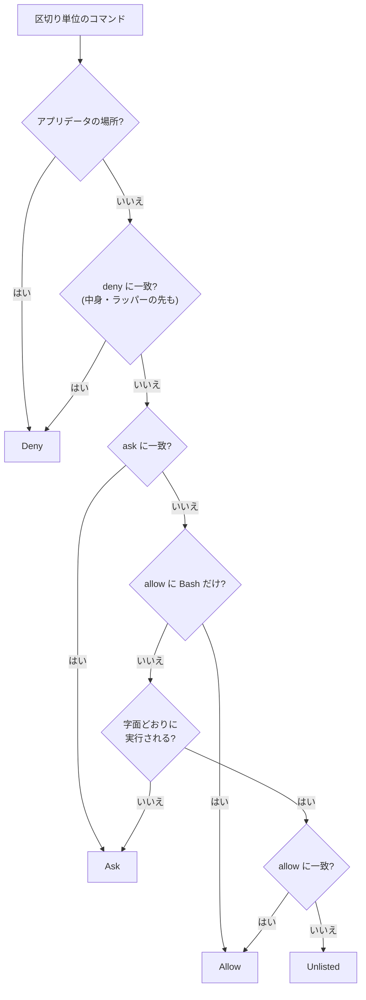

# API 方式の権限(settings.json)

API 方式(ホストのツールループ)で、`run_command` のシェルコマンドと、Web 検索・ページ取得(Anthropic のサーバーツール)の可否を決める仕組み。Claude Code の settings.json と同じ書式(`permissions.allow` / `ask` / `deny`)で書く。実装は `services/permissions.rs`、画面は設定の「権限」タブの settings.json。使われ方は [agent-command-tasks.md](agent-command-tasks.md)。

ホストのツールループで動くとき(API 方式のパーソナル)だけ使う。コンテナ内の Claude Code で動くとき(ワークは常に、パーソナルは Bedrock 方式のとき)は、Sandbox タブの settings.json を Claude Code 自身が解釈する([sandbox.md](sandbox.md))。リーダーはコマンドを実行しない。

| 方式 | コマンド・Web 検索の可否 |
| --- | --- |
| ワーク(Bedrock のみ) | Sandbox タブの settings.json(Claude Code) |
| パーソナル・Bedrock 方式 | Sandbox タブの settings.json(Claude Code) |
| パーソナル・API 方式 | 権限タブの settings.json(このページ) |

## 設計方針

- 判定は Claude Code と同じく **deny > ask > allow**。どれにも一致しないコマンドは**毎回承認**する。独自の規則(作業計画との連動、ナレッジの外への実行の制限、上書きリダイレクトの確認フラグなど)は持たない。
- 既定の許可・確認・拒否は、アプリ側で持つ**初期値(プリセット)**として入っているだけで、すべて編集できる。消せばその保護は無くなる。「初期値に戻す」でいつでもプリセットへ戻せる。
- 設定とは別に、**アプリデータの保護**だけは常に効かせる(設定で外せない。[後述](#アプリデータの保護設定で外せない))。
- 構文解析による静的な検査。内容を確かめられない形は、許可のルールを効かせず承認にする。

## ルールの書き方

各リストに、Claude Code と同じ形のルールを書く。

| ルール | 意味 |
| --- | --- |
| `Bash` / `Bash(*)` | すべてのコマンド |
| `Bash(git status)` | 完全一致 |
| `Bash(git log:*)` | 前方一致(`git log` そのもの、または `git log` の後に空白と引数が続くもの。`git logx` には一致しない) |
| `Bash(npm run *)` | `*` は任意の文字列(空白を含む)。末尾の「空白と `*`」は引数なしにも一致する |
| `Bash(git * main)` | 途中のワイルドカード |
| `WebSearch` / `WebFetch` | Web 検索・ページ取得 |

- コマンドは空白をそろえた字面で照合する(クォートは外す)。
- `Bash` 以外のツール名(`Read` など)は、API 方式では対象外(ファイル操作は [agent-file-tools.md](agent-file-tools.md) のサンドボックスで制限する)。

## コマンドの判定(`classify`)

コマンドをパイプ・`&&`・`;`・`$(...)`・バッククォート・`sh -c`・`eval`・`find -exec` などで区切り、それぞれを判定して**最も厳しい結果**を採る。入れ子は 4 段まで解析し、超えたら承認にする。

| 結果 | 動作 |
| --- | --- |
| `Allow` | 承認なしで実行 |
| `Unlisted` | どのルールにも一致しない。「今回だけ実行」か「許可に加えて実行」を選ぶ承認(`allow_command`) |
| `Ask` | 毎回承認(`command`)。`ask` に一致したもの、または内容を確かめられないもの |
| `Deny` | 実行しない。理由を LLM に返し、ユーザーへ説明させる |

厳しさは `Allow` < `Unlisted` < `Ask` < `Deny`。

- **deny・ask** は、字面のほか、ラッパー(`env` `nohup` `xargs` など)と環境変数の指定を外した形、コマンド名をパスなしにした形(`/bin/rm` → `rm`)にも照合する。`sh -c '…'`・`eval`・`find -exec`・`$(...)` の中身も別のコマンドとして判定し、拒否はそのまま効く。
- **allow** は、コマンドの字面どおりに実行されるものにだけ効かせる。次の形は、allow に一致しても承認(`Ask`)にする(`Bash` だけの許可のときを除く)。

| 形 | 例 | 理由 |
| --- | --- | --- |
| 中で別のコマンドを実行する | `sh -c '…'`、`eval …`、`find … -exec …` | 中身は字面の許可と別 |
| 環境変数の前置き・ラッパー | `GIT_EXTERNAL_DIFF=… git diff`、`ls \| xargs cat` | 読み取り系のコマンドに別の動作をさせられる |
| 変数の引数 | `cat $HOME/x` | 行き先を確認できない(正規表現の行末の `$` は対象外) |
| ファイルへのリダイレクト | `echo hi > out.txt` | 書き込みになる(`/dev/null` は除く) |
| 変数への代入だけ | `a=secrets; cat $a.json` | 後のコマンドの引数を実行時に変えうる |
| コマンド置換 | `echo $(ls)` | 結果が引数になり、行き先を確認できない |

## Web 検索・ページ取得

Anthropic のサーバーツールは、1 回ごとに止めて確認できない。そのため、**allow に指定子なし(`WebSearch` / `WebFetch`)で書かれ、ask・deny のどちらにも書かれていない**ときだけツールを渡す。ask・deny には指定子つき(`WebFetch(domain:…)`)でも、書けばそのツールは渡さない。どれにも書かなければ渡さない。指定子つきの許可(ドメインの限定など)は対象外。

渡したツールの分だけ、システムプロンプトに使い方を足す(`tool_loop::web_guide`)。回数の上限は調整項目(`web_search_max` / `web_fetch_max`)。端末内のモデルには渡さない。

## 初期値(プリセット)

初期値はアプリ側(`permissions::Preset`)で持ち、3 種類から選ぶ。未保存のときは、初めて読んだときに「標準」を DB へ書き出す。画面の「初期値に戻す」で、選んだプリセットを確認のうえ保存する(いまの内容は捨てる)。

| プリセット(`id`) | allow | ask | deny |
| --- | --- | --- | --- |
| 標準(`standard`。既定) | 読み取り系のコマンド、`WebSearch`、`WebFetch` | 破壊的になりうる操作、書き出し系のオプション | 安全のための拒否 |
| 読み取りのみ(`read_only`) | 読み取り系のコマンド | 書き出し系のオプション | 安全のための拒否 |
| すべて許可(`permissive`) | `Bash`、`WebSearch`、`WebFetch` | なし | なし |

- 「すべて許可」は拒否のルールを持たない。アプリデータの保護([後述](#アプリデータの保護設定で外せない))だけは効く。
- 「読み取りのみ」は Web 検索・ページ取得を使わない(検索 1 回ごとに課金されるため)。書き込み系のコマンドは、どれにも一致しないので毎回承認になる。

各項目の中身:

| 項目 | 内容 |
| --- | --- |
| 読み取り系のコマンド | `ls` `pwd` `cat` `head` `tail` `wc` `file` `stat` `du` `df` `which` `whoami` `date` `uname` `sw_vers` `echo` `grep` `rg` `find` `tree` `git status` `git log` `git diff` `git show` `ps` `id` `hostname` `uptime` `printenv` `basename` `dirname` `realpath` `readlink` `diff` `cut` `tr` `lsof` と、`git rev-parse` `git ls-files` `git blame` `git remote -v` `git branch --list` `git tag -l` `git config --get` など読み取りだけのサブコマンドを `Bash(<コマンド>:*)` にしたもの |
| 破壊的になりうる操作 | `git push` `git reset --hard` `git clean` `git checkout --` `git restore` `git branch -D` `git stash drop` `git stash clear` `git rebase` `mv` `dd` `truncate` `kill` `killall` `pkill` `osascript` `chmod -R` `chown -R` `brew uninstall` `brew remove` `npm publish` `cargo publish` を `Bash(<コマンド>:*)` にしたもの |
| 書き出し系のオプション | 読み取り系に書き出し・別コマンドの起動をさせるもの(`Bash(find *-exec*)` `Bash(find *-fprint*)` `Bash(* --output*)` `Bash(rg *--pre*)` `Bash(git *--ext-diff*)` `Bash(git *--textconv*)` `Bash(tree *-o *)` など) |
| 安全のための拒否 | OS に影響するコマンド(`shutdown` `reboot` `launchctl` `diskutil` `defaults write` など)と削除・権限昇格(`rm` `rmdir` `unlink` `shred` `sudo` `su` `doas`)を `Bash(<コマンド>:*)` にしたもの、`Bash(find *-delete*)`、機密ファイルを引数に含むもの(`Bash(*secrets.json*)` `Bash(*timeline.db*)` `Bash(*sandbox.env*)` `Bash(*.aws/credentials*)` `Bash(*.ssh/id_*)` `Bash(*.netrc*)` `Bash(*.gnupg/*)`) |

OS に影響するコマンドと削除・権限昇格の拒否(`default_deny_rules`)は、Sandbox タブの settings.json の雛形と、空のときに渡す既定の拒否にも使う([sandbox.md](sandbox.md))。

## アプリデータの保護(設定で外せない)

settings.json のルールは字面の一致なので、ワイルドカード(`secrets.jso?`)や作業ディレクトリの指定で避けられる。そのため、ルールとは別に**場所**で守る。`Bash` だけの許可でも外れない。

- アプリデータのフォルダ(`~/Library/Application Support/MyAssistant/`。そのワークスペース自身のナレッジを除く)を、作業ディレクトリ・パス引数・リダイレクト先・`--opt=<パス>`・ワイルドカードの手前のフォルダ・シンボリックリンクのどれで指しても、読み取り系を含めて `Deny`。ほかのワークスペースのナレッジ・DB・キーにも届かない。
- アプリデータを含む範囲(ホームなど)を再帰的に読むコマンド(`rg`、`grep -r`、`find … -exec`)は `Deny`(対象のフォルダを絞るよう返す)。
- `Library/` 配下へのワイルドカード指定は `Deny`(具体的なパスを指定するよう返す)。

## 保存先

エージェントごとの DB(`timeline.db` の `app_settings`)のキー `api_claude_settings`(JSON の文字列)。`run_command` のたびに読み直す(再起動不要)。未保存なら、初めて読んだときに「標準」のプリセットを書き出す。

画面では、既定は閲覧だけで、「編集」で書き換えられる。「保存」で検証してから保存し、不正なら保存せず理由だけ出す(内容は含めない)。

- JSON のオブジェクトで、64KB まで。
- `permissions` はオブジェクト、`allow` / `ask` / `deny` は文字列の配列(1 リスト 500 件、1 項目 300 文字まで)。
- `permissions` 以外の項目(`model` など)は書いてもよいが、API 方式では使わない。
- 空では保存できない。初期値へ戻すときは、プリセットを選んで「初期値に戻す」を押す(確認のうえ保存する)。
- 画面には、保存した内容がどのプリセットと同じか(「初期値「標準」」など)、または「編集済み」かを出す。

保存した内容が壊れていれば(検証を通らない値が DB にある)、許可・確認は空、拒否は既定の拒否(`default_deny_rules`)だけとして扱う(すべて承認が要る)。

### 許可への追加

`Unlisted` のコマンドの承認では、「今回だけ実行」(許可へ加えない)と「許可に加えて実行」を選べる。後者を選ぶと、`add_allow` が `Bash(<パターン>:*)` を `permissions.allow` へ加えて保存する(ほかの項目はそのまま残る)。この承認は画面のボタンでだけ行える(音声では拒否だけ)。パターンは、サブコマンドで性質が変わるツール(`git` `npm` `pnpm` `yarn` `cargo` `brew` `docker` `gh` `kubectl` `go` `pip`)では `git log` のようにサブコマンドまで含める。シェル・インタプリタ・ラッパー、パスで指したコマンド(`./tool`)は候補にしない(毎回の承認になる)。

## 以前の設定

以前の独自形式のコマンド権限(キー `command_policy`)と Web 検索のオン/オフ(キー `web_access`)は、移行せずに DB のマイグレーション(版 7)で削除した。以前に書き出した設定ファイルの `command_policy` は、取り込み時に読み飛ばす。

## バックアップ・設定の書き出し

設定のエクスポートとワークスペース間のコピーに含まれる([data-and-settings.md](data-and-settings.md))。取り込み時は同じ検証を通し、不正なら何も変更しない。

## 既知の限界

[agent-command-tasks.md](agent-command-tasks.md#既知の限界) を参照。静的な検査のため、`python -c` の中身や実行時に決まるパスは見ない。プリセットの許可(`find` `echo` など)でも、上の表の形に当たらない書き込みは字面の許可で通る点に注意する。
