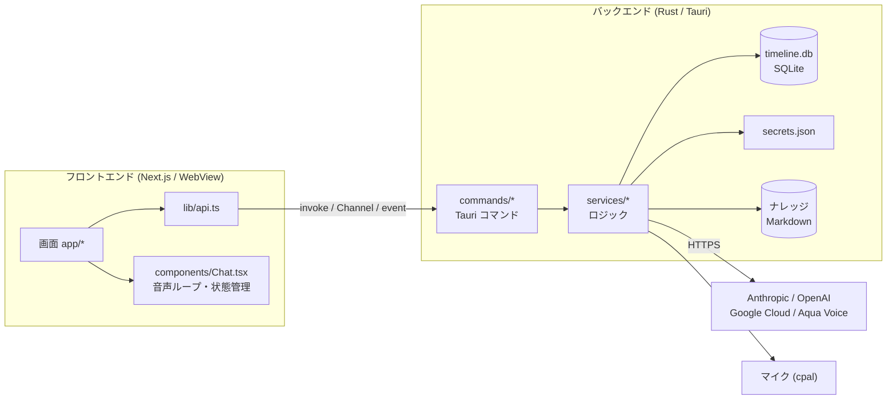

# 全体構成

## 概要

音声で対話するデスクトップ AI エージェント。UI は Next.js の静的エクスポート、処理はすべて Rust(Tauri 2)側にあり、フロントエンドは `invoke` で Tauri コマンドを呼ぶ。



## 技術スタック

| 層 | 採用 |
| --- | --- |
| フロントエンド | Next.js 16(`output: "export"`)、React 19、Tailwind CSS 4、shadcn/ui |
| バックエンド | Tauri 2、tokio、reqwest、rusqlite、cpal(録音)、whisper-rs(ローカル音声認識) |
| 保存 | SQLite(`timeline.db`)、Markdown(ナレッジ)、JSON(`secrets.json`) |

静的エクスポートのため、フロントエンドにサーバー機能(API Routes、Server Actions 等)は無い。バックエンド処理は Rust の Tauri コマンドに実装し、`src/lib/api.ts` 経由で呼ぶ。

## ディレクトリと責務

| パス | 責務 |
| --- | --- |
| `src/app/` | 画面。`/`(対話)、`/knowledge`、`/setup`、`/shortcuts`、`/debug` |
| `src/components/` | 対話 UI(`Chat.tsx`)、字幕、波形、承認モーダル、実行ログなど。`ui/` は shadcn/ui |
| `src/lib/` | Tauri 呼び出し(`api.ts`)、音声での承認・切り替えの判定、字幕の同期、ショートカット、料金の概算 |
| `src-tauri/src/commands/` | フロントエンドから呼ぶ薄いコマンド層。入力検証と状態の受け渡しだけを行う |
| `src-tauri/src/services/` | ロジック本体(LLM、音声、ナレッジ、エージェント、コマンド判定など) |
| `src-tauri/src/db/` | SQLite のスキーマとクエリ |
| `src-tauri/src/utils/` | エラー型(`error.rs`)、パスのサンドボックス(`path.rs`) |
| `src-tauri/src/tray.rs` | メニューバー常駐 |

## フロントエンドとバックエンドの通信

| 方式 | 用途 |
| --- | --- |
| `invoke` | 通常のコマンド呼び出し。すべて `lib/api.ts` に集約する |
| `Channel<AgentEvent>` | `send_chat` の進捗(ツール呼び出し、承認要求、コマンド出力)を発話ごとに流す |
| イベント(`emit`) | ナレッジの更新通知(`knowledge-updated`) |

エラーは `AppError`(`utils/error.rs`)を `{ code, message, source? }` にシリアライズして返す。フロントエンドは `code` で分岐し、`message` に API キーは含まれない。

## 管理状態(`app.manage`)

| 型 | 役割 |
| --- | --- |
| `Db` | SQLite 接続(Mutex) |
| `SessionContexts` | 会話ごとの訂正履歴の節のキャッシュ |
| `GraphCache` | ナレッジのグラフ索引のキャッシュ |
| `AgentState` | 承認の応答口と、実行中の依頼の中断トークン |
| `Recorder` | マイク録音 |
| `SttEngine` / `VadEngine` | Whisper / Silero VAD のロード済みモデル |
| `BatchGuard` | 整理バッチの多重実行防止 |

## 起動と終了

```mermaid
sequenceDiagram
  participant App as アプリ
  participant Loop as 定期バッチ
  App->>App: アプリデータ作成 → secrets 初期化 → Db を開く
  App->>App: 状態の登録、デバッグログの出力先を決定
  App->>App: メニューバー(トレイ)を作成
  App->>Loop: 非同期タスクを起動
  loop 設定した間隔(既定30分)
    Loop->>Loop: 整理バッチ(未処理ログがあれば)
  end
  Note over App: 終了要求
  App->>App: 終了を一旦止め、未処理ログを1回だけ整理(最大30秒)
  App->>App: 終了
```

- 間隔は毎回の待ちの前に読み直すため、設定の変更は次の待ちから反映される。
- ウィンドウの閉じる操作は「隠す」に差し替える(メニューバー常駐、[frontend.md](frontend.md))。終了はトレイメニューの「終了」から行う。
