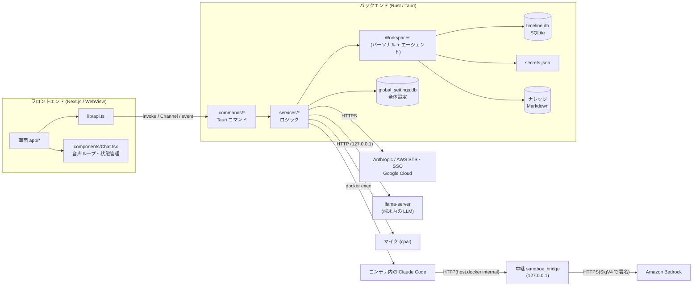
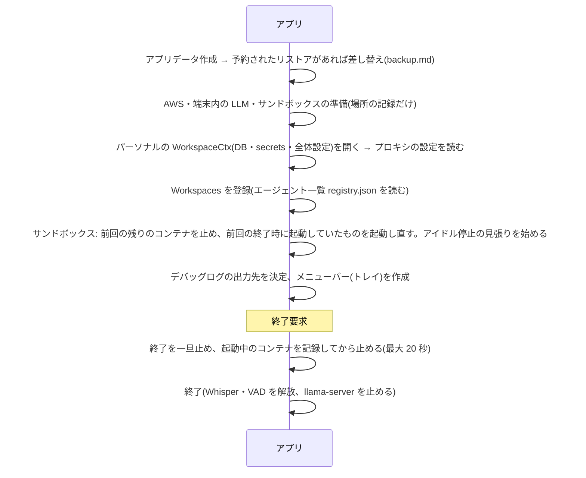

# 全体構成

## 概要

音声で対話するデスクトップ AI エージェント。UI は Next.js の静的エクスポート、処理はすべて Rust(Tauri 2)側にあり、フロントエンドは `invoke` で Tauri コマンドを呼ぶ。LLM の処理は、API 方式ならホストのこのアプリが、Bedrock 方式(ワークのエージェントは常に)ならエージェント専用コンテナの Claude Code が行う([llm-settings.md](llm-settings.md))。

## 技術スタック

| 層 | 採用 |
| --- | --- |
| フロントエンド | Next.js 16(`output: "export"`)、React 19、Tailwind CSS 4、shadcn/ui |
| バックエンド | Tauri 2、tokio、reqwest、rusqlite、cpal(録音)、whisper-rs(ローカル音声認識) |
| 保存 | SQLite(`timeline.db`)、Markdown(ナレッジ)、JSON(`secrets.json`)はワークスペースごとに別々に持つ([workspace.md](workspace.md))。全体設定は SQLite(`work/global_settings.db`)。詳細は [data-and-settings.md](data-and-settings.md) |
| 外部プロセス | llama-server(端末内の LLM。[local-llm.md](local-llm.md))、docker CLI(サンドボックス。[sandbox.md](sandbox.md)) |
| 待ち受け | サンドボックスの中継(`127.0.0.1` の空きポート。Bedrock の署名とコンテナ用の AWS の一時キーの配布。[sandbox-aws.md](sandbox-aws.md)) |

静的エクスポートのため、フロントエンドにサーバー機能(API Routes、Server Actions 等)は無い。バックエンド処理は Rust の Tauri コマンドに実装し、`src/lib/api.ts` 経由で呼ぶ。

## ディレクトリと責務

| パス | 責務 |
| --- | --- |
| `src/app/` | 画面。`/`(対話)、`/knowledge`、`/knowledge/all`、`/skills`、`/setup`、`/global`、`/shortcuts`、`/debug` |
| `src/components/` | 対話 UI(`Chat.tsx`)、字幕、波形、承認モーダル、実行ログなど。`ui/` は shadcn/ui |
| `src/lib/` | Tauri 呼び出し(`api.ts`)、ワークスペースの状態(`workspace.ts`)、依頼の状態(`agentRuns.ts`)、サンドボックスの状態(`useSandbox.ts`)、音声での承認・切り替えの判定、字幕の同期、ショートカット、表示言語(`i18n/`) |
| `src-tauri/src/commands/` | フロントエンドから呼ぶ薄いコマンド層。入力検証と状態の受け渡しだけを行う |
| `src-tauri/src/services/` | ロジック本体(LLM、音声、ナレッジ、ツールループ、コマンド判定、サンドボックス、リーダーなど)。ワークスペースの管理は `workspace.rs` |
| `src-tauri/src/db/` | SQLite のスキーマとクエリ |
| `src-tauri/src/utils/` | エラー型(`error.rs`)、パスのサンドボックス(`path.rs`)、版の文字列(`version.rs`) |
| `src-tauri/src/tray.rs` | メニューバー常駐 |
| `src-tauri/resources/` | 同梱物(Silero VAD のモデル、サンドボックスの標準 Dockerfile) |
| `docs/` | 設計書。バイナリへ埋め込み、チャットの設計書ツールから読める([agent-file-tools.md](agent-file-tools.md#設計書ツール)) |

## フロントエンドとバックエンドの通信

| 方式 | 用途 |
| --- | --- |
| `invoke` | 通常のコマンド呼び出し。すべて `lib/api.ts` に集約する |
| `Channel<TaskEvent>` | `send_chat` の進捗(テキスト、ツール呼び出し・結果、承認要求、コマンド出力、配布の下書き、終了)を発話ごとに流す。切り替えて戻ったときは `task_resume` で接続し直す |
| `Channel<Progress>` | 端末内の LLM の取得の進み具合(`download_local_llm`) |
| イベント(`emit`) | 下表 |

| イベント | 内容 |
| --- | --- |
| `knowledge-updated` | ナレッジの更新(会話のキャプチャ・整理) |
| `workspace-changed` | 選択中のワークスペース・エージェント一覧の変更 |
| `task-attention` | 開いていないエージェントの承認待ち・完了・失敗([workspace.md](workspace.md#開いていないエージェントの通知)) |
| `aws-mfa-required` / `aws-sso-required` / `aws-sso-finished` | MFA コードの入力要求、SSO の承認要求と終了。どれも用途(`slot`: `bedrock` / `sandbox`)を持つ([security.md](security.md#aws-認証awsrs)、[sandbox-aws.md](sandbox-aws.md)) |
| `sandbox-build-progress` | イメージのビルドの進み具合([sandbox.md](sandbox.md)) |
| `navigate` | メニューバー・トレイからの画面移動 |

エラーは `AppError`(`utils/error.rs`)を `{ code, message, source? }` にシリアライズして返す。フロントエンドは `code` で分岐し、`message` に API キーは含まれない。

## 管理状態(`app.manage`)

| 型 | 役割 |
| --- | --- |
| `Workspaces` | ワークスペース(パーソナル + エージェント)の一覧、読み込み済みの `WorkspaceCtx`、選択中の ID、全体設定。別枠のリーダー(`leader()`。エージェントの一覧にも選択の対象にも入らないが、開いて使える。[leader.md](leader.md))も持つ |
| `SessionContexts` | 会話ごとの訂正履歴の節のキャッシュ(セッション ID で識別) |
| `GraphCache` | ナレッジのグラフ索引のキャッシュ(ルートのパスで識別。1 件分) |
| `Recorder` | マイク録音 |
| `SttEngine` / `VadEngine` | Whisper / Silero VAD のロード済みモデル |
| `VoicevoxEngine` | VOICEVOX CORE のロード済みライブラリ |

ワークスペースごとの状態は `WorkspaceCtx`(`services/workspace.rs`)にまとめる。

| `WorkspaceCtx` の項目 | 役割 |
| --- | --- |
| `db` | SQLite 接続(Mutex)。設定・会話・提案(リーダーは台帳も) |
| `secrets` | API キー・AWS 設定の保管庫(`secrets.json`) |
| `debug` | デバッグログの出力先(ワークスペースごと) |
| `global` | 全体設定(全ワークスペースで同じものを共有。[global-settings.md](global-settings.md)) |
| `shared.aws` | AWS の一時クレデンシャル、SSO のトークン、MFA 入力・SSO 承認の待ち(用途 `bedrock` / `sandbox` ごと) |
| `shared.batch` | 整理バッチ(と統合の提案の承認)の多重実行防止 |
| `shared.task` | 作業の依頼の実行状態(承認の応答口・中断・進捗と結果の記録)。切り替えても止まらない |
| `shared`(削除の印) | 削除されたエージェントを、裏の処理が確かめて止まるための印(`ensure_alive`) |

`shared` は、同じワークスペースを別々に開いた `WorkspaceCtx`(一時的に開いたものと読み込み済みのもの)の間で共有する。

コマンドは引数 `ctx: Ctx` で選択中のワークスペースを受け取る。処理の途中で切り替わっても、受け取った `ctx` を使い続けるため、DB・キー・ナレッジが混ざらない。詳細は [workspace.md](workspace.md)。

## 起動と終了

- 整理バッチは自動では動かさない。ナレッジ画面の「今すぐ整理」だけが起動する([knowledge.md](knowledge.md))。
- ウィンドウの閉じる操作は「隠す」に差し替える(メニューバー常駐、[frontend.md](frontend.md#メニューバー常駐src-taurisrctrayrs))。終了はトレイメニューの「終了」から行う。
- 端末内の LLM のサーバーは、最初の要求のときに起動する([local-llm.md](local-llm.md))。
