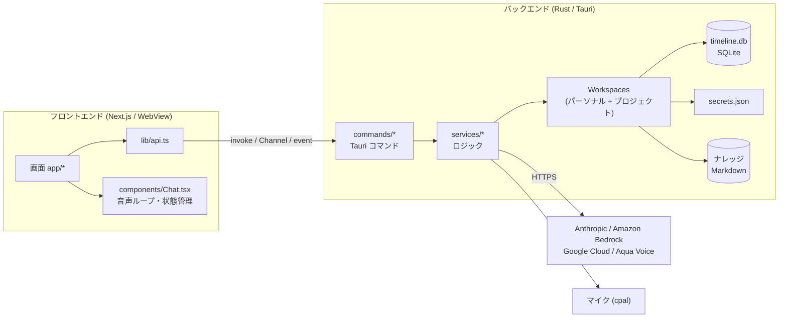

# 全体構成

## 概要

音声で対話するデスクトップ AI エージェント。UI は Next.js の静的エクスポート、処理はすべて Rust(Tauri 2)側にあり、フロントエンドは `invoke` で Tauri コマンドを呼ぶ。



## 技術スタック

| 層 | 採用 |
| --- | --- |
| フロントエンド | Next.js 16(`output: "export"`)、React 19、Tailwind CSS 4、shadcn/ui |
| バックエンド | Tauri 2、tokio、reqwest、rusqlite、cpal(録音)、whisper-rs(ローカル音声認識) |
| 保存 | SQLite(`timeline.db`)、Markdown(ナレッジ)、JSON(`secrets.json`)。ワークスペースごとに別々に持つ([workspace.md](workspace.md)) |

静的エクスポートのため、フロントエンドにサーバー機能(API Routes、Server Actions 等)は無い。バックエンド処理は Rust の Tauri コマンドに実装し、`src/lib/api.ts` 経由で呼ぶ。

## ディレクトリと責務

| パス | 責務 |
| --- | --- |
| `src/app/` | 画面。`/`(対話)、`/knowledge`、`/setup`、`/workspace`(ワークのプロジェクト管理)、`/shortcuts`、`/debug` |
| `src/components/` | 対話 UI(`Chat.tsx`)、字幕、波形、承認モーダル、実行ログなど。`ui/` は shadcn/ui |
| `src/lib/` | Tauri 呼び出し(`api.ts`)、ワークスペースの状態(`workspace.ts`)、音声での承認・切り替えの判定、字幕の同期、ショートカット、料金の概算 |
| `src-tauri/src/commands/` | フロントエンドから呼ぶ薄いコマンド層。入力検証と状態の受け渡しだけを行う |
| `src-tauri/src/services/` | ロジック本体(LLM、音声、ナレッジ、エージェント、コマンド判定など)。ワークスペースの管理は `workspace.rs` |
| `src-tauri/src/db/` | SQLite のスキーマとクエリ |
| `src-tauri/src/utils/` | エラー型(`error.rs`)、パスのサンドボックス(`path.rs`) |
| `src-tauri/src/tray.rs` | メニューバー常駐 |

## フロントエンドとバックエンドの通信

| 方式 | 用途 |
| --- | --- |
| `invoke` | 通常のコマンド呼び出し。すべて `lib/api.ts` に集約する |
| `Channel<AgentEvent>` | `send_chat` の進捗(ツール呼び出し、承認要求、コマンド出力)を発話ごとに流す |
| イベント(`emit`) | ナレッジの更新通知(`knowledge-updated`)、ワークスペースの変更通知(`workspace-changed`) |

エラーは `AppError`(`utils/error.rs`)を `{ code, message, source? }` にシリアライズして返す。フロントエンドは `code` で分岐し、`message` に API キーは含まれない。

## 管理状態(`app.manage`)

| 型 | 役割 |
| --- | --- |
| `Workspaces` | ワークスペース(パーソナル + プロジェクト)の一覧、読み込み済みの `WorkspaceCtx`、選択中の ID |
| `SessionContexts` | 会話ごとの訂正履歴の節のキャッシュ(セッション ID で識別) |
| `GraphCache` | ナレッジのグラフ索引のキャッシュ(ルートのパスで識別。1 件分) |
| `Recorder` | マイク録音 |
| `SttEngine` / `VadEngine` | Whisper / Silero VAD のロード済みモデル |

ワークスペースごとの状態は `WorkspaceCtx`(`services/workspace.rs`)にまとめる。

| `WorkspaceCtx` の項目 | 役割 |
| --- | --- |
| `db` | SQLite 接続(Mutex)。設定・会話・使用量 |
| `secrets` | API キー・AWS 設定の保管庫(`secrets.json`) |
| `aws` | AWS の一時クレデンシャルと MFA 入力待ち |
| `batch` | 整理バッチの多重実行防止 |
| `debug` | デバッグログの出力先(ワークスペースごと) |
| `agent` | 作業の依頼の実行状態(承認の応答口・中断・進捗と結果の記録)。切り替えても止まらない |
| (削除の印) | 削除されたプロジェクトを、裏の処理が確かめて止まるための印(`ensure_alive`) |

コマンドは引数 `ctx: Ctx` で選択中のワークスペースを受け取る。処理の途中で切り替わっても、受け取った `ctx` を使い続けるため、DB・キー・ナレッジが混ざらない。詳細は [workspace.md](workspace.md)。

## 起動と終了

```mermaid
sequenceDiagram
  participant App as アプリ
  participant Loop as 定期バッチ
  App->>App: アプリデータ作成 → パーソナルの WorkspaceCtx(Db・secrets)を開く
  App->>App: Workspaces を登録(プロジェクト一覧 registry.json を読む)、デバッグログの出力先を決定
  App->>App: メニューバー(トレイ)を作成
  App->>Loop: 非同期タスクを起動
  loop 30秒ごとに見直し(各ワークスペースの間隔は既定30分)
    Loop->>Loop: ワークスペースごとに、自分の間隔で整理バッチ(未処理ログがあれば)
  end
  Note over App: 終了要求
  App->>App: 終了を一旦止め、開いているワークスペースの未処理ログを1回だけ整理(最大30秒)
  App->>App: 終了
```

- 定期バッチ(`services/scheduler.rs`)は、パーソナルと各プロジェクトを、それぞれの設定の間隔で独立して動かす。30 秒ごとに見直し、前回から自分の間隔が過ぎたワークスペースだけを、ワークスペースごとの別タスクで実行する。遅い・失敗するワークスペースが他を待たせない。
- 間隔の変更は、読み込み済みのワークスペースでは次の見直し(30 秒以内)に反映される。
- 読み込んでいないプロジェクトは、間隔を読むときと実行するときだけ一時的に開き、開いたままにしない。切り替えていないワークスペースの整理も止まらない。
- ウィンドウの閉じる操作は「隠す」に差し替える(メニューバー常駐、[frontend.md](frontend.md))。終了はトレイメニューの「終了」から行う。
