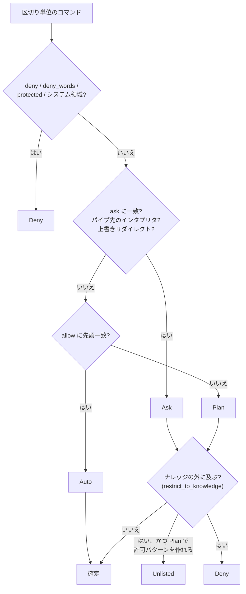

# コマンドの許可・拒否(Command Policy)

`run_command` で実行するシェルコマンドの可否を判定する仕組み。実装は `services/command_policy.rs`、画面は設定の Command Policy。使われ方は [agent-command-tasks.md](agent-command-tasks.md)。

## 設計方針

- 許可・ask・拒否・機密・システム領域などの**規則はすべてナレッジの JSON ファイルで管理**し、コマンドごとに読み直す(再起動不要)。
- `rm` 系・OS に影響するコマンド・機密ファイルの拒否も、**初期値としてファイルに書き出すだけ**で、ユーザーが編集できる。消せばその保護は無くなる。
- 構文解析による**静的な検査**。解釈できないものは安全側(承認が必要)に倒す。

## 判定(`classify_in`)

コマンドをパイプ・`&&`・`;`・`$(...)`・バッククォート・`sh -c` などで分解し、**最も厳しい判定**を採用する。入れ子は 4 段まで解析し、超えたら個別承認にする。`env` `nohup` `xargs` などのラッパーと環境変数の指定は飛ばして、実際のコマンドを見る。

| 判定 | 動作 |
| --- | --- |
| `Auto` | 承認なしで実行 |
| `Plan` | 承認済み計画の範囲内なら実行。計画が無ければ失敗を返し、計画外なら個別承認 |
| `Ask` | 計画の中でも毎回承認 |
| `Unlisted` | 許可リストにない、読み取り系以外の**単純なコマンド**(通常は `Plan` になるもので、パス引数・リダイレクト先を持たない)が、作業ディレクトリのためナレッジの外に及ぶ。承認されれば許可リストに加えて実行 |
| `Deny` | 実行しない。理由を LLM に返し、ユーザーへ説明させる |

厳しさは `Auto` < `Plan` < `Ask` < `Unlisted` < `Deny`。



## 既定の規則

### 許可(Auto): 読み取り系

`ls` `pwd` `cat` `head` `tail` `wc` `file` `stat` `du` `df` `which` `whoami` `date` `uname` `sw_vers` `echo` `grep` `rg` `find` `tree` `git status` `git log` `git diff` `git show`。版 3 で `ps` `id` `hostname` `uptime` `printenv` `basename` `dirname` `realpath` `readlink` `diff` `cut` `tr` `lsof` と、`git rev-parse` `git ls-files` `git blame` `git remote -v` `git branch --list` `git tag -l` など読み取りだけのサブコマンドを加えた。

### 拒否(Deny)

すべて編集でき、消せばその保護は無くなる。

| フィールド | 既定 | 備考 |
| --- | --- | --- |
| `deny_words` | `rm` `rmdir` `unlink` `shred` `sudo` `su` `doas` | **コマンドのどの位置にあっても**拒否(`xargs rm`、`git rm`、`sh -c 'rm …'` 経由も) |
| `deny` | `shutdown` `reboot` `halt` `poweroff` `launchctl` `systemsetup` `diskutil` `csrutil` `nvram` `pmset` `scutil` `networksetup` `dscl` `spctl` `tmutil` `mount` `defaults write` など `find -delete` | 引数の途中でも一致 |
| `protected` | `secrets.json` `timeline.db` | 引数に含むコマンドを拒否(API キー・DB の漏えい防止) |
| `system_paths` | `/System` `/usr` `/bin` `/sbin` `/etc` `/Library` `/private/etc` `/dev` | ここへの書き込み・リダイレクトを拒否 |
| `system_exceptions` | `/usr/local` | `system_paths` のうち書き込みを許す |

### 個別承認(Ask)

`ask` の既定: `git push` `git reset --hard` `git clean` `git checkout --` `git restore` `git branch -D` `git stash drop` `git stash clear` `git rebase` `mv` `dd` `truncate` `kill` `killall` `pkill` `osascript` `chmod -R` `chown -R` `brew uninstall` `brew remove` `npm publish` `cargo publish`。

フラグ: `confirm_overwrite`(リダイレクト `>` での上書きを毎回承認)、`confirm_pipe_to_shell`(パイプで受けたコードの実行、`curl … | sh` など)。

## 実行範囲(`Scope`)

フラグ `restrict_to_knowledge`(既定オン)。**読み取り系(Auto)を除き**、作業ディレクトリ(`cwd`)とパス引数・リダイレクト先はナレッジ配下に限る。

- 外を指すもの(`/tmp/x`、`../x`、`~/x`、`$HOME/x` など変数で組み立てたパス)は、`Deny`(理由: 読み取り系以外はナレッジの中でしか実行できない)。ただし、パス引数・リダイレクト先を持たない単純なコマンドが作業ディレクトリだけ外にある場合は、許可リストへ加える承認(`Unlisted`)を求める。`Ask` の規則に当たったものは対象外で、`Deny` になる。
- `..` とシンボリックリンクは解決して判定する(存在する最も深い祖先を正規化して残りを付け直す)。
- `ls /etc` や `cat ~/x` のような**読み取りはナレッジの外でも実行できる**。
- コマンドを区切り単位ごとに見るので、`ls /etc && mkdir a` は後者だけが検査される。

## ポリシーファイル

`<ナレッジ>/.my-assistant/command-policy.json`。`run_command` のたびに読み直し、初回に既定値を書き出す。

```json
{
  "version": 3,
  "allow": ["ls", "git status"],
  "ask": ["npm publish"],
  "deny": ["curl"],
  "deny_words": ["rm", "sudo"],
  "protected": ["secrets.json", "timeline.db"],
  "system_paths": ["/System", "/usr"],
  "system_exceptions": ["/usr/local"],
  "confirm_overwrite": true,
  "confirm_pipe_to_shell": true,
  "restrict_to_knowledge": true
}
```

設定画面では `allow` / `ask` / `deny` の 3 つのリストを 1 行 1 項目で編集して保存できる。保存は空行・重複を除き(1 リスト 200 件・1 項目 200 文字まで)、次のコマンドから有効になる(入力欄を離れたときに自動保存)。ファイルを直接編集してもよい。

### マッチの規則

- **ワイルドカード**: 各項目の語に `*`(任意の文字列)が使える。`aws s3 *` は `aws s3` 以下すべて(末尾の `*` は残りの引数すべて・なしも含む)、`aws * delete-*` は途中の語や語の中の指定。単独の `*` は任意の 1 語。拒否は `*` の許可でも緩まない(拒否リストを編集しない限り)。
- **`allow`**: コマンド名と引数の**先頭**が一致したときだけ Auto(`git -C x status` は一致しない)。
- **`ask` / `deny`**: 引数の途中でも一致する。deny が最優先。
- `allow` に一致したコマンドは読み取り系(Auto)として扱われるため、**ナレッジ内に限る実行範囲の検査も受けない**。広い `allow`(`aws s3 *` など)は、ローカルへの書き込みも承認なしで通る点に注意。

### 保護と移行

- 隠しフォルダなので、LLM のファイルツール(一覧・読み取り・作成)からは触れない。
- ファイルが壊れていれば許可リストは空として扱う(拒否などは初期値のまま)。
- `version` が無い・古いファイルは、後から追加した初期値(拒否・ask・読み取り系の許可)を足して書き戻す。ユーザーの項目は残す。
- 設定画面の「初期値を読み込む」で初期値に戻せる(保存するまで反映されない)。

### 許可リストへの追加

`Unlisted` のコマンドをユーザーが承認すると、`add_allow` がパターンを許可リストへ加える。パターンは、サブコマンドで性質が変わるツール(`git` `npm` `pnpm` `yarn` `cargo` `brew` `docker` `gh` `kubectl` `go` `pip`)では `git log` のようにサブコマンドまで含める。シェル・インタプリタ・ラッパーなど、何でも実行できるものは候補にしない。

## バックアップ

設定のエクスポートに含まれる([data-and-settings.md](data-and-settings.md))。取り込み時は同じ検証(`cleaned`)を通して保存する。

## 既知の限界

[agent-command-tasks.md](agent-command-tasks.md#既知の限界) を参照。静的な検査のため、`python -c` の中身や実行時に決まるパスは見ない。
