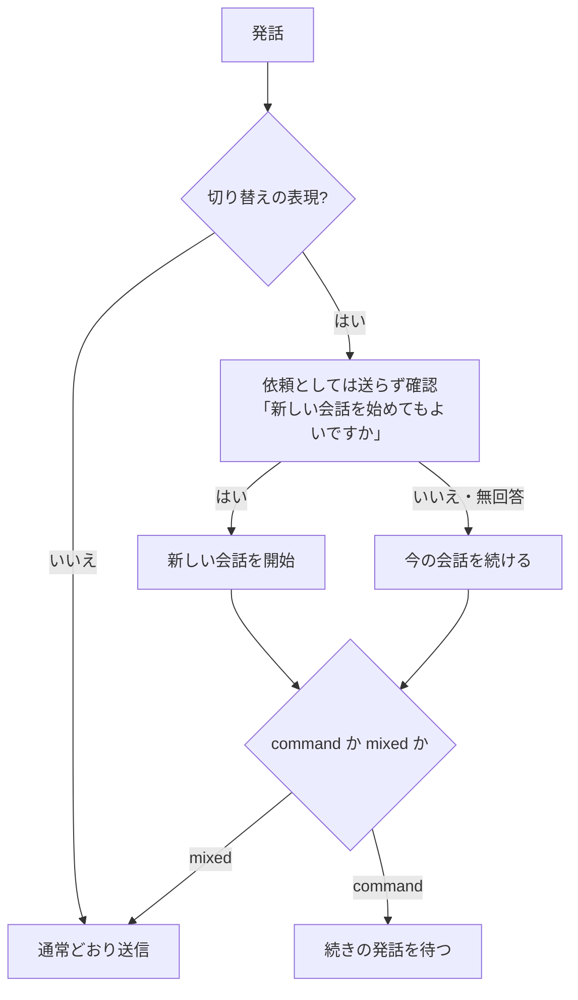
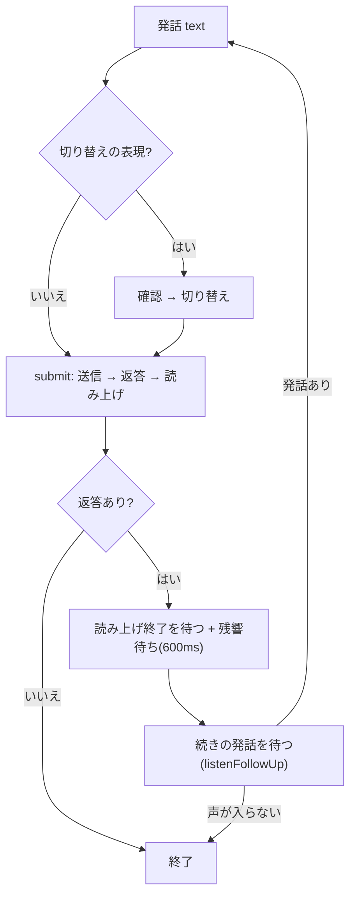

# 会話の継続と切り替え

「会話(セッション)」は、LLM へ送る文脈と要約の単位。**切り替えを明示しない限り、会話は継続する**(放置しても切り替わらない)。実装は主に `src/components/Chat.tsx` と `src/lib/voiceCommands.ts`、`src/lib/voiceApproval.ts`。

## セッション

- セッション ID は UUID で、フロントエンドが発行する。`conversation_logs.session_id`、要約、キャプチャのファイル名(先頭 8 文字)の単位になる。
- 画面を移動して `Chat` が作り直されても同じ ID を引き継ぐ(モジュールレベルで保持)。リロード・アプリの再起動で新しいセッションになる。
- 再起動後の新しいセッションでは、バックエンドが直近のナレッジ(`<previous_context>` / `<related_knowledge>`)から文脈を復元する([chat-flow.md](chat-flow.md))。

## 切り替わる条件

次の**どちらかだけ**。

1. 対話画面の「新しい会話」ボタン。
2. 切り替えを明示する発話に、音声またはボタンで「はい」と答えたとき。

コマンド実行の依頼・承認・実行、設定画面への移動では切り替わらない。依頼は進行中の会話の続きとして扱い、システムプロンプトにも「ユーザーが明示しない限り、会話の切り替えやクリアを提案しない」と書く(`services/agent.rs::shell_guide`)。

## 切り替えの発話の検出(`voiceCommands.ts`)

LLM は使わず、語句の表で判定する。表記は `normalize`(全角半角・大文字小文字・空白と句読点の除去)で揃えて部分一致で調べる。

- 語句の例: 「新しい会話」「話題を変えて」「会話をリセット」「別の話」「最初からやり直し」「全部忘れて」。
- 「リセット」「リセットして」など、発話全体がそれだけのときも対象。
- 語句を除き、語尾(「してください」「お願いします」など)も除いた残りが 3 文字以下なら `command`(切り替えの指示だけ)、それより長ければ `mixed`(切り替えに続けて別の依頼がある)。

- 確認の音声は保存済みの定型音声 `switch_confirm`([voice-output.md](voice-output.md))。未作成またはミュート中は画面表示のみ。
- 答えは音声(`judgeAnswer`)または画面のボタンで受ける。聞き取れなければ聞き直し、待ち時間(12 秒)内に答えがなければ「いいえ」(今の会話を続ける)。
- 作業中(`busy`)の発話は検出の対象外。

## 肯定・否定の判定(`voiceApproval.ts`)

承認要求([agent-command-tasks.md](agent-command-tasks.md))と切り替えの確認で共通。LLM には判定させない。

| 発話 | 判定 |
| --- | --- |
| 30 文字を超える、または空 | `unclear`(返答として扱わない) |
| 否定語を 1 つでも含む(「いいえ」「やめて」「キャンセル」「stop」など) | `no`。肯定語があっても否定を優先(「はい、でもやめて」は実行しない) |
| 肯定語を含む(「はい」「お願い」「実行して」「OK」など) | `yes` |
| それ以外 | `unclear`。待ち続けて聞き直す |

## 自動で会話を続けるループ(`converse`)

- 返答を読み上げた後は自動で音声入力を再開し、続けて話せる。設定した秒数(`voice_idle_secs`、既定 3 秒)声が入らなければ会話を終える。
- 常時待機が有効なら、読み上げ(字幕のみの返答)でも続ける。起動ワードを呼び直さなくてよい([wake-standby.md](wake-standby.md))。
- 「新しい会話」の操作ごとに `resetEpoch` を増やし、会話中のループは開始時と違えば終わる。切り替え待ちの間に新しい会話へ移った場合、古い返答は表示しない。

## 送信(`submit`)

1. 録音の文字を `sendChat` で送る。進捗(`AgentEvent`)は実行ログと承認モーダルに反映する。
2. 読み上げが有効なら、**音声を作って再生を始めてから**返答を字幕に表示する(字幕を再生位置に合わせるため。[voice-output.md](voice-output.md))。
3. 待っている間に別の会話へ切り替わっていたら、返答を捨てる。
