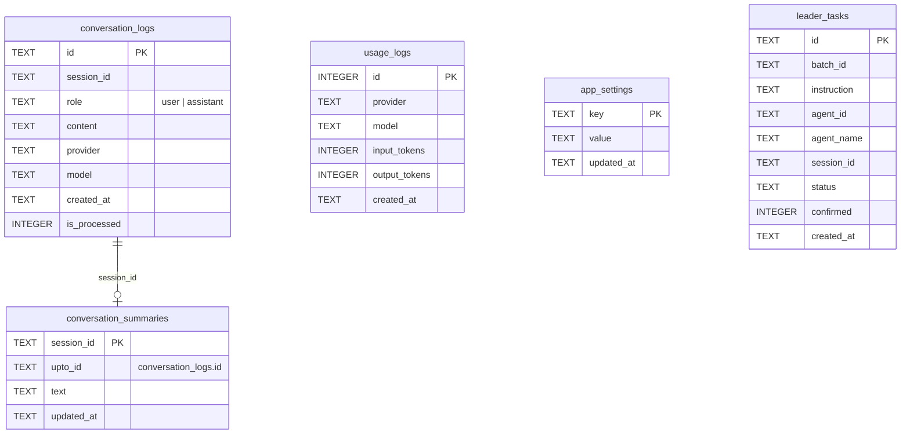

# 保存データと設定

## 保存場所

すべてアプリデータディレクトリ(識別子 `MyAssistant`)に保存され、リポジトリには含まれない。macOS では `~/Library/Application Support/MyAssistant/`。

下の表の `timeline.db`・`secrets.json`・ナレッジは**ワークスペースごと**に持つ。パーソナルは下記のとおりアプリデータ直下、ワークのエージェントは `workspaces/<UUID>/` 配下に同じ構成で置く([workspace.md](workspace.md))。`models/`・`voice/`・`voicevox/`・`llm/` は端末で共有する。

| パス | 内容 |
| --- | --- |
| `timeline.db` | SQLite。会話ログ・要約・使用量・アプリ設定(リーダーは台帳も)。WAL の `timeline.db-wal` / `-shm` と、マイグレーション前の複製 `timeline.db.bak-v<版>` が並ぶことがある |
| `secrets.json` | API キー。**平文 JSON**(権限 0600)。OS のキーチェーンは使っていない([security.md](security.md)) |
| `models/` | Whisper モデル(`ggml-large-v3-turbo-q5_0.bin` / `ggml-small.bin`) |
| `voice/` | 定型音声(`<id>-<ハッシュ>.mp3` / `.wav`。声ごとに別ファイル) |
| `voicevox/` | VOICEVOX CORE・ONNX Runtime・OpenJTalk 辞書・音声モデル(設定画面から取得) |
| `llm/` | ローカル LLM の llama-server(`bin/`)・Qwen のモデル(`models/`)・取得の記録・サーバーのログ(設定画面から取得。[local-llm.md](local-llm.md)) |
| ナレッジ | 既定ではアプリデータ配下(`knowledge/`)。設定で任意のフォルダへ変更できる([knowledge.md](knowledge.md)) |
| `proxy/secrets.json` | 通信のプロキシのパスワード(権限 0600。ワークスペースを問わず1つ。[proxy.md](proxy.md)) |
| `tts_dictionary.json` | 読み上げ辞書(ユーザー登録分) |
| `workspaces/registry.json` | ワークのエージェント一覧(id・名称・イメージカラー・作成日時) |
| `workspaces/<UUID>/` | エージェントのデータ。`timeline.db`・`secrets.json`・`knowledge/`・`tts_dictionary.json` をパーソナルと同じ名前で持つ |

旧名(識別子 `dev.longin.tachicoma-agent`)のフォルダがあり新しいフォルダが無ければ、起動時に丸ごと改名して引き継ぐ(`services/legacy_data.rs`)。ナレッジ内の旧 `.tachicoma/` もコマンド権限の読み書き時に `.my-assistant/` へ改名する。旧名の設定ファイルも取り込める。

## SQLite スキーマ(`db/`)

表ごとの読み書きは `db/{logs,summaries,usage,settings,ledger}.rs`、スキーマと版の管理は `db/schema.rs` に分けている。



| テーブル | 役割 | 主な操作 |
| --- | --- | --- |
| `conversation_logs` | 会話の一次ログ(時系列)。インデックスは `(session_id, created_at)` と `is_processed` | 保存、直近 N 件・全件の取得、未処理の取得、処理済みにする |
| `turn_events` | 発話ごとの実行ログ(ツール呼び出し・コマンド出力のJSON)。ユーザー発話の行ID(`user_log_id`)に結び付け、会話の再開時に画面へ戻す | 取得、置換 |
| `conversation_summaries` | 会話(セッション)ごとの要約。どこまで畳み込んだか(`upto_id`)と本文([chat-flow.md](chat-flow.md)) | 取得、upsert |
| `usage_logs` | LLM 呼び出しごとのトークン使用量。インデックスは `created_at` | 記録、当月(ローカル時間)のプロバイダー・モデル別集計 |
| `app_settings` | エージェントごとのキー・値の設定(値は文字列。構造のあるものは JSON) | 取得、upsert、削除 |
| `leader_tasks` | リーダーの台帳。**リーダーのDBにだけある**([workspace.md](workspace.md)) | 追加、一覧、状態・確認済みの更新 |

- `conversation_logs.is_processed`: 整理バッチがナレッジへ反映したかどうか([knowledge.md](knowledge.md))。
- **日時**はすべて UTC・ミリ秒・`Z` 付きの RFC3339(例 `2026-01-01T00:00:00.123Z`)。SQL の既定値(`schema::NOW_SQL`)と Rust で作る値(`db::now()`)を同じ形にしている。
- 接続は `Mutex<Connection>`。ロックが毒されても(パニック後)中身を使い続ける。同じファイルを複数の接続で開くことがある(整理バッチで一時的に開くなど)ため、WAL(`timeline.db-wal` / `-shm`)と `busy_timeout`(5 秒)を設定する。
- DB の役割(`db::Role`)は、開くときにワークスペースの ID で決める。リーダーは `leader_tasks` を作り、それ以外は以前のアプリが作っていた空の `leader_tasks` を消す(行があれば残して警告する)。

### 版とマイグレーション(`db/schema.rs`)

版は `PRAGMA user_version` で持ち、開くたびに未適用の版を古い順に当てる。各版は 1 つのトランザクション(書き込みのロックを取ってから版を確かめる)で当てる。

| 版 | 内容 |
| --- | --- |
| 0 | 版管理を入れる前のDB(または空のDB) |
| 1 | その時点のスキーマ(既存のDBには何もしない) |
| 2 | 日時を上記の形式へそろえる(既定値を含む。表を作り直し、行の `rowid` は引き継ぐので同時刻の並びも変わらない)。`usage_logs(created_at)` のインデックスを追加 |
| 3 | 会話の要約を `app_settings`(キー `summary:<session_id>`)から `conversation_summaries` へ移す。読めない値は移さない(従来も読まれていなかった) |

- **既存のDBを書き換える前に複製を残す**: 同じフォルダへ `timeline.db.bak-v<元の版>` として `VACUUM INTO` で書き出す。同名のファイルがあれば日時を付けた別名にし、上書きしない。複製できなければDBを開かない(書き換えない)。空のDB(新規作成)では複製しない。
- 複製と WAL のファイルも名前が `timeline.db` で始まるため、コマンド実行の保護の対象になる([command-policy.md](command-policy.md))。
- 列や表を変えるときは `MIGRATIONS` の末尾に版を足す。既存の版の SQL は変えない。

## 設定項目(`app_settings`)

| キー | 値 | 既定 | 設定画面 |
| --- | --- | --- | --- |
| `routing` | `Route`(JSON) | Claude が使えれば Sonnet | 対話画面のモデル選択 |
| `web_access` | `0` / `1` | 有効 | Web Search |
| `shell_access` | `0` / `1` | 有効 | Command Tasks |
| `stt_engine` | `local` / `google` / `aqua` | `local` | Voice Link |
| `stt_language` | `auto` / `ja` / `en` / `zh` / `ko` | `auto` | Voice Link |
| `tts_engine` | `google` / `voicevox` | `voicevox` | Voice Link |
| `voicevox_style` | VOICEVOX のスタイル ID(数値の文字列) | `3`(ずんだもん ノーマル) | Voice Link |
| `whisper_revision` | Hugging Face のリビジョン(ブランチ・タグ・コミット) | `main` | Voice Link(取得バージョン) |
| `voicevox_versions` | 取得する配布物のバージョン(JSON: `core` / `onnxruntime` / `models` / `dict_release` / `dict`。未指定の項目は既定値) | CORE `0.17.1`、ONNX Runtime `1.23.2`、音声モデル `0.17.0`、辞書 `v1.11.1` / `1.11` | Voice Link(取得バージョン) |
| `tuning` | 上限の調整項目(JSON) | 下表 | Limits |
| `batch_route` | `Route`(JSON) | 既定 | ナレッジ画面 |
| `proofread_route` | `Route`(JSON)。空は校正オフ | オフ | Proofread(設定の音声タブ) |
| `skills_route` | `Route`(JSON) | 軽量モデル | スキル画面([skills.md](skills.md))。設定のエクスポートの対象外 |
| `debug_mode` | `0` / `1` | 無効 | Debug Mode |
| `agent_data` | エージェントデータ(JSON `{enabled, text}`。エージェントのみ。コピー・エクスポートの対象外) | 有効・空 | Agent Data |
| `knowledge_dir` | 絶対パス(空なら既定) | 既定 | ナレッジ画面 |
| `debug_log_dir` | デバッグログの出力先(空なら既定) | 既定 | Debug Mode |
| `leader_prompt` / `leader_max_active` | リーダーの指示(JSON)と同時に動かす依頼の上限(リーダーのみ) | 既定 | リーダーの設定 |

**全体設定に移した項目**(ベースプロンプト `base_instructions`、OS通知、表示言語、音声入力の待ち時間 `voice_timing`、起動ワード `wake_enabled` / `wake_words`、パーソナルデータ `user_profile`、ナレッジ整理の間隔 `batch_interval_minutes`、通信のプロキシ `proxy_enabled` / `proxy_url` / `proxy_username`)は、`app_settings` ではなく `workspaces/global_settings.json` に保存する。エージェントのDBに残った同名の古い値は、全体設定の取り込みが済んだあとにDBを開いたとき消す([global-settings.md](global-settings.md))。

**キーの一覧(`services/settings_registry.rs`)**: すべての設定キーについて、保存先(エージェントのDB / 全体設定)と、書き出し・コピーの対象かどうか(と検証方法)をここで決める。書き出しの項目、全体設定のバックアップの項目、初回の取り込み・古い値の削除の対象は、この一覧から作る。保存先の取り違えを防ぐため、DBは全体設定のキーを、全体設定はエージェントのキーを書き込みで拒否する。新しい設定を足すときは、この一覧にも登録する。

自動保存: 調整項目と Command Policy は、入力欄を離れたときに保存する。

## 調整項目(`tuning.rs`)

エージェントごとの上限(`tuning`)と、全体設定の音声入力の待ち時間(`voice_timing`)に分かれる。

数値は保存時に範囲内へ丸める。未保存・欠けた項目は既定値。非数は下限になる。

| 項目 | 意味 | 範囲 | 既定 |
| --- | --- | --- | --- |
| `web_search_max` | 1 回の依頼で行うインターネット検索の上限回数 | 1〜20 | 5 |
| `web_fetch_max` | 1 回の依頼で行うページ取得の上限回数 | 1〜20 | 5 |
| `voice_idle_secs` | 声が入らなければ音声入力を終える時間(秒) | 1.0〜30.0 | 3.0 |
| `utterance_silence_secs` | 話し終わりとみなす無音の長さ(秒) | 0.5〜5.0 | 1.2 |
| `release_tail_secs` | エージェントを離してから録音を止めるまでの猶予(秒) | 0.0〜3.0 | 0.5 |
| `history_exchanges` | 過去の会話をそのまま LLM へ渡す往復数の上限。超えた分は要約 | 2〜30 | 10 |

## 使用量の表示

- `usage_logs` を当月(ローカル時間)で集計し、プロバイダー・モデル別に表示する(`UsageHud`)。
- 金額は `src/lib/pricing.ts` の単価(100 万トークンあたり、USD)からの**概算**で、請求額とは一致しない場合がある。単価が未登録のモデルは金額を出さない。
- このアプリ経由の呼び出しだけのローカル集計。Web 検索の追加料金や、Google Cloud・Aqua Voice の利用料は含まない。

## 設定のエクスポート・インポート(`settings_transfer.rs`)

別の端末への移行やバックアップに使う。設定画面の Backup。会話・ナレッジ・API キーを含むアプリ全体のバックアップは [backup.md](backup.md)。

### 対象

- `app_settings` のうち、キーの一覧(`settings_registry`)で書き出しの対象にした**設定項目**(`routing`・`web_access`・`shell_access`・`stt_engine`・`stt_language`・`tts_engine`・`voicevox_style`・`tuning`・`batch_route`・`proofread_route`・`debug_mode`。全体設定の項目は含まない)と、**コマンド権限**(`command-policy.json`)。
- **含まない**: API キー、エージェントデータ(`agent_data`)、端末ごとに異なるナレッジ・デバッグログの保存先(`knowledge_dir` / `debug_log_dir`)、取得する配布物の版(`whisper_revision` / `voicevox_versions`)、リーダーの設定、会話ごとの要約、会話の履歴。
- 全体設定の項目(ベースプロンプト・パーソナルデータ・起動ワード・音声入力の待ち時間・ナレッジ整理の間隔・表示言語・OS通知)は含まない。全体設定には別のエクスポート/インポートがある([global-settings.md](global-settings.md))。
- 書き出し・取り込みの対象は、選択中のワークスペースの設定。ワークスペース間で設定を写すには、各エージェントの設定の「その他」にある設定のコピーを使う([workspace.md](workspace.md))。

### ファイル

```json
{
  "app": "MyAssistant",
  "version": 1,
  "exported_at": "2026-10-29T03:00:00Z",
  "settings": { "routing": "{...}", "shell_access": "1" },
  "command_policy": { "version": 3, "allow": [] }
}
```

- 保存先は、ダイアログで選んだ拡張子 `.json` の絶対パスのみ。既定のファイル名は `myassistant-settings-<日時>.json`。
- 未設定の項目は書き出さない。

### 取り込み

1. 1,000,000 バイトを超えるファイルは拒否する。
2. `app` と `version` を確認する(別アプリのファイル・未対応の版は拒否)。
3. **全項目を検証してから書き込む**。型ごとに検証する: フラグ(`0` / `1`)、JSON として読めるか、許可された値のどれか、文字列(20,000 文字以内)、パーソナルデータ(通常の入力と同じ検証)。**不正な項目が 1 つでもあれば何も変更しない**。
4. ファイルに無い項目は変更しない。未知の項目は読み飛ばす(`skipped`)。
5. コマンド権限は検証(`cleaned`)して保存する。デバッグモードの出力先を決め直す。

結果は `{ applied, skipped }` で返す。
