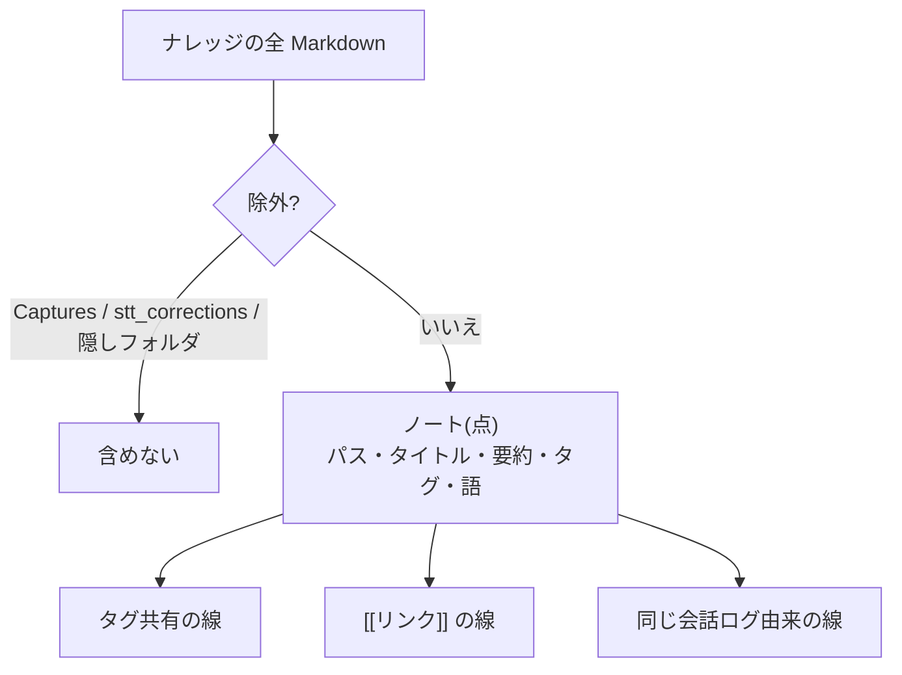

# ナレッジのグラフ索引と想起

ナレッジ(Markdown ノート)を、ノート=点、つながり=線のグラフにして、発話に関連するノートを辿って選ぶ。実装は `services/graph.rs`。**LLM もネットワークも使わない**(ローカルのみ・無料)。

## 目的

- 全ノートを毎回渡すとトークンを圧迫する。かといって直近のノートだけでは、話題に合わない。
- 発話に一致するノートを起点に、タグ・リンク・同じ会話由来のつながりを最大 2 ホップ辿って、関連ノートの**要約だけ**をシステムプロンプトへ渡す。本文はモデルが必要なときに `read_file` で読む(段階読み)。

## 索引の構築(`Graph::build`)

### 点(ノート)

| 項目 | 内容 |
| --- | --- |
| 要約 | 本文から見出しを除いた最初の段落を 1 行(120 文字)にする |
| 語(照合用) | タイトル・タグ・パス由来の語(重み大)と、本文先頭 20,000 文字の語(重み小) |

語の切り方(`terms`): 英数字は単語(2 文字以上)、それ以外(日本語など)は 2 文字ずつの N-gram。ひらがなだけの N-gram(「ので」「ます」など)は手がかりにならないため捨てる。

### 線(つながり)

線は無向で、同じ組が複数の理由でつながるときは重みを足し、強い方の理由を残す。

| 種類 | 重み | 備考 |
| --- | --- | --- |
| 共通タグ | `ln(ノート数 / そのタグを持つノート数)` | 珍しいタグほど強い。1 件だけ・全ノートが持つタグではつながない |
| `[[リンク]]` | 2.0 | 参照先はパス(拡張子の有無を問わない)・ファイル名・タイトルで探す。`\|` 以降の表示名と `#` 以降の見出しは除く |
| 同じ会話由来 | 1.0 | `source_log_ids` が共通するノート同士 |

## 想起(`Graph::recall`)

### 1. 起点の採点(`seed_scores`)

- 得点 = Σ(語の重み × IDF)。タイトル・タグ・パスの一致は本文の 3 倍の重み。IDF は `1 + ln((N+1)/(df+1))`。
- **半数を超えるノートに出る語はありふれているため数えない**(ノートが少ないうちは除く)。
- **1 語だけの本文一致は起点にしない**(「設定」などで偶然一致することが多いため)。2 語以上の一致、またはタイトル・タグの一致があるものだけ。
- 上位 3 件を起点にする。起点が 1 件も無ければ空(呼び出し側は直近更新のノートで代える。[chat-flow.md](chat-flow.md))。

### 2. 辿る

- 起点の関連度は「得点 / 最高得点」。各ホップで `関連度 × 0.5 × (線の重み / その点の最大の線の重み)` を隣へ伝える。
- 関連度が 0.1 未満の伝搬は捨てる。すでにより高い関連度で届いている点は更新しない。最大 2 ホップ。
- 結果には「なぜ選ばれたか」を付ける: 「キーワード一致: …」「〇〇とタグ「x」を共有」「〇〇とリンク」「〇〇と同じ会話から整理」。

### 3. 渡す(`render`)

`パス | タイトル — 要約 (理由)` の行を、合計 1,500 文字まで並べる。最大 5 件。

## キャッシュ(`GraphCache`)

- 索引の構築は全ファイルを読むため、結果をキャッシュする。
- 無効化は**指紋**で判定する: ナレッジ内のファイルのパス・サイズ・更新時刻のハッシュ(中身は読まない)。変わったときだけ作り直すので、Obsidian など外部での編集にも追従する。

## 既知の限界

- 照合は語の一致(N-gram + IDF)で、意味的な類似(埋め込み)は使わない。言い換えには弱い。
- ノートが少ないうちは、一致が偶然に左右されやすい。
