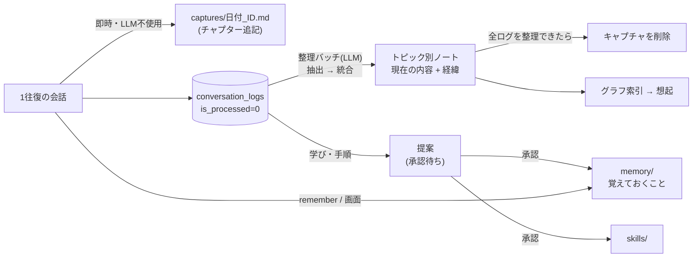
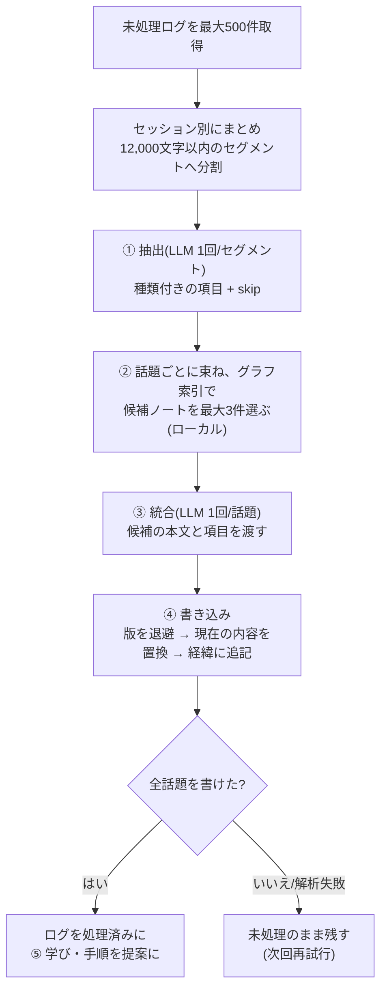

# ナレッジ

会話を Markdown のノートとして蓄積し、あとで参照・想起できるようにする機能。実装は `services/knowledge.rs`(読み書き・版の退避)、`services/batch.rs`(整理バッチ)、`services/proposals.rs`(学びの提案・棚卸し)、`commands/knowledge.rs`、画面は `src/app/knowledge/page.tsx`。

## 全体像



1. **キャプチャ**: 応答のたびに、確認なしで会話をそのまま書き出す(LLM は使わない)。整理前の生の記録で、ユーザーが後から読み返せる。
2. **整理バッチ**: 未処理のログから LLM で項目(事実・決定・手順・学び・未完了)を取り出し、話題ごとに既存ノートへ統合して「現在の内容」を書き直す。学びと再利用できる手順は、承認待ちの提案にする。
3. **想起**: ノートを索引にして、会話に関連するものをシステムプロンプトへ渡す([knowledge-graph.md](knowledge-graph.md))。
4. **記憶**: 覚えておくことを、頼まれたとき・提案を承認したときに記録し、毎回の会話で渡す([memory.md](memory.md))。整理バッチが直接書くことはない。

## 保存先

- 既定はワークスペースのフォルダ配下(パーソナルはアプリデータの `knowledge/`、エージェントは `work/<UUID>/knowledge/`)。ナレッジはワークスペースごとに完全に分かれ、ほかのワークスペースからは読めず、設定のコピーでも写さない([workspace.md](workspace.md))。ナレッジ画面で任意のフォルダに変更できる(`set_knowledge_dir`)。ほかのワークスペースの保存先と重なる場所(同じ場所・親子関係)は選べない。絶対パスのみ受け付け、実際に書き込めるか確認してから保存する。**既存のノートは移動しない**。
- 手編集されても読めるよう、Frontmatter は引用符なしの値・ブロック形式のリスト(`- item`)も受け付け、未知のキーは無視する。Frontmatter が壊れていても本文は保持する。
- 保存先を変えると、デバッグログの出力先も追従する([debug-log.md](debug-log.md))。
- フォルダ名はすべて小文字にそろえる。固定のフォルダ(`inbox/`・`memory/`・`skills/`・`captures/`・`preferences/`・`data/`)だけでなく、整理・画面・LLM のツール・インポートで作るカテゴリのフォルダも、保存時に小文字へ直す(例: `Dev/Rust` → `dev/rust`)。ファイル名は変えない。
- ワークスペースを開くとき、アプリが使うフォルダを、無ければ作る(`knowledge::ensure_system_dirs`)。`inbox/`・`skills/`・`captures/`・`preferences/`・`memory/`(リーダーを除く)と、`data/`(サンドボックス)。画面から見えるようにするためで、空のままでもよい。`debug-logs/` は、出力先を変えられるため、デバッグログを書くときに作る。これらのフォルダは、ナレッジ画面からは削除できない(警告を出す)。
- すでにある大文字のフォルダは、ワークスペースを開くとき(起動時・切り替え時)に、一度だけ小文字へ改名する(`knowledge::lowercase_dirs`)。`.` 始まりのフォルダ・シンボリックリンク・`data/` 配下は触らない。小文字の同名の別フォルダがあるとき(大文字小文字を区別するボリューム)は、改名せず警告する。ノート内の Frontmatter の `category` は書き換えない(一覧のカテゴリはパスから決まる)。
- 直下の `data/` は、サンドボックスの担当システムのフォルダ(ソースコードなど)で、ノートとして扱わない(一覧・索引・整理・初期化・書き出し・バックアップの対象外。画面には表示するが、閲覧だけ)([sandbox.md](sandbox.md))。
- **ナレッジ画面はすべて表示する**: ツリーには、`data/` と `.` 始まり(`.my-assistant/` など)も出す(`knowledge::list_for_screen`・`list_other`・`list_dirs`)。整理・索引・提案が使うノート一覧(`knowledge::list`)からは、今までどおり除く。残す制限は、3階層までと、シンボリックリンクを辿らないことだけ。
- `data/` 配下と `.` 始まりを含むパスは**閲覧専用**(`knowledge::is_read_only`、画面は `isReadOnlyPath`)。中身は開けるが、画面からの保存・作成・改名・削除は拒否し、ツリーにも操作を出さない。

## ノートの形式

```markdown
---
title: "タイトル"
summary: "ノート全体の現在の要約(1行)"
category: "Development/Tauri"
tags: ["tauri", "rust"]
created_at: "2026-10-29T03:00:00Z"
updated_at: "2026-10-29T04:00:00Z"
source_log_ids: ["<会話ログID>", "…"]
---

# タイトル

(現在の内容: 整理の統合のたびに LLM が書き直す「今の正しい状態」)

## 経緯

### 2026-10-29T03:00:00Z

- 作成

### 2026-10-29T04:00:00Z

- 〇〇を△△へ変更
```

- 本文は `## 経緯` の見出しで 2 つに分ける。見出しより前(タイトル行を除く)が**現在の内容**、以降が**経緯**。
  - 現在の内容は、整理で同じ話題の情報が来るたびに書き直す。手で書いた部分も対象で、古い記述・矛盾する記述は新しい情報で置き換える。
  - 経緯は追記だけ。整理のたびに、`### <時刻>` の節として今回の変更点を足す。
  - LLM が現在の内容に `## 経緯` を書いても、`### 経緯` に下げて構造を壊させない。
- `summary` は統合のたびに書き直す 1 行の要約(200 文字まで)。想起の一覧に使う([knowledge-graph.md](knowledge-graph.md))。空なら Frontmatter に書かない。
- Frontmatter の無い手書きのノートは、ファイル名をタイトルとして扱う。
- ファイルは `<カテゴリ(最大2階層)>/<ファイル名>.md`。カテゴリが空なら `inbox`。ファイル名・カテゴリは `slug`(英数字・日本語・`_`・`-` 以外を `_` に置換)で安全な名前にする。
- 書き込みのとき、タグ・`source_log_ids` は併合し、`updated_at` を更新する。
- 書き込みは一時ファイル経由のアトミックな置き換え(途中失敗でファイルを壊さない)。

### 版の退避

- 整理(統合)で書き換える前と、統合の提案でノートを消す前に、元のファイルを `.my-assistant/history/<カテゴリ>/<ファイル名>/<時刻>_<連番>.md` へ写す。ノートごとに新しい 10 版まで残す。
- 同じ時刻に何度書き換えても前の版を潰さないよう、連番は同じ時刻の最大の番号の次にする(消えた古い版の番号は使わない)。
- ノートの画面の「履歴」で版の一覧と中身を見て、「この版に戻す」で戻せる(確認あり。戻す前の内容も版として残る)。
- 隠しフォルダなので、一覧・グラフ・LLM のファイルツールからは見えない。ノートの名前を変えると、それまでの版はたどれなくなる。
- 一覧は最大 3 階層。シンボリックリンクは辿らない。

### 特別な場所

| パス | 内容 |
| --- | --- |
| `captures/` | 会話のキャプチャ(`日付_セッションID先頭8文字.md`)。整理後に削除される。整理の追記先候補・グラフ索引には含めない |
| `memory/pinned.md` | 記憶([memory.md](memory.md))。グラフ索引・直近の文脈・整理の追記先には含めず、専用の節として渡す |
| `preferences/stt_corrections.md` | 聞き取りの訂正履歴([voice-input.md](voice-input.md))。グラフ索引には含めず、専用の節として渡す |
| `.my-assistant/history/` | ノートの書き換え前の版。隠しフォルダのため LLM のファイルツールから見えない |
| `.my-assistant/history/` | 整理で書き換える前のノートの版([版の退避](#版の退避))。初期化で消える |
| `skills/<名前>/SKILL.md` | スキル([skills.md](skills.md))。通常のノートとして一覧に出るが、整理バッチ・グラフ・直近の文脈・初期化の対象にはしない。LLM の `create_file` では作れない |
| `debug-logs/` | デバッグモードのログ([debug-log.md](debug-log.md)) |

## キャプチャ

- 1 往復ごとに、セッション単位のファイルへ `## HH:MM` のチャプターとして「**ユーザー**/**アシスタント**」を追記する。ファイルは初回に `capture` タグ付きで作り、以降はセッション ID で探して追記する。
- 整理バッチの最後に、全ログが整理済みのセッションのキャプチャを削除する(後始末)。今回の整理に関わらず、過去に整理済みのものも対象で、未処理ログがなくても、API キー未登録でも行う。
  - ファイル名にはセッション ID の先頭 8 文字しかないため、先頭が同じセッションのどれかに未処理ログがあれば残す。
  - DB にログが 1 件もないキャプチャは、整理済みと判断できないので残す。
  - 削除数は `BatchReport.captures_removed` で画面へ返す。

## 整理バッチ(`batch.rs`)

### 実行タイミング

| トリガー | 備考 |
| --- | --- |
| ナレッジ画面の「今すぐ整理」 | 手動のみ。自動・定期・終了時の実行は無い |

`run_guarded` が多重実行を防ぐ(`BatchGuard`。統合の提案の承認とも共有)。実行中のときは何もせず `None` を返す。未処理ログなし・API キー未登録のときは整理せず後始末だけ行い、削除したキャプチャがなければ `None` を返す。

### 処理



#### ① 抽出(`PromptId::Organize`)

会話ログから、後で役立つ項目を取り出して JSON で返させる。

```json
{"items":[{"kind":"fact|decision|procedure|lesson|todo","topic":"話題","text":"内容","tags":[],"log_ids":[],
           "skill":{"name":"…","description":"…","body":"…"}}],
 "skip_log_ids":[]}
```

| 種類 | 内容 |
| --- | --- |
| `fact` | 事実・調べた結果・設定値(不明な種類もこれとして扱う) |
| `decision` | 決めたこと・方針 |
| `procedure` | 作業の手順。今後も繰り返し使える汎用的な手順なら `skill` の下書きを付ける |
| `lesson` | ユーザーからアシスタントへの指摘・好み・やり方の指定 |
| `todo` | 未完了の作業 |

- 挨拶・雑談・聞き取れなかった入力など、読み返す価値のないものは `skip_log_ids` に入れる(処理済みにする)。
- LLM が捏造したログ ID は除く。本文が空の項目は捨てる。
- 項目も、ノートにしない(実在する ID の)ログも無ければ、失敗として扱う。

#### ② 候補の選び方

- 項目を `topic` ごとに束ねる(大文字小文字を区別しない。空は「その他」)。
- 話題名と項目の文で、グラフ索引の想起(`Graph::recall`)を引き、上位 3 件を候補にする。索引はセグメントごとに作り直し、前のセグメントで書いたノートも候補に入るようにする。

#### ③ 統合(`PromptId::Consolidate`)

候補ノートの現在の内容(1 件 6,000 文字まで)・既存カテゴリ(最大 50)・項目を渡し、次を返させる。

```json
{"target":"更新する候補のパス、または null","new":{"category":"…","filename":"…"},
 "title":"…","summary":"…","tags":[],"current":"新しい現在の内容","history":"今回の変更点"}
```

- `target` が候補に無いパスなら信用せず、新しいノートとして扱う。新しいノートの場所が既存のファイルと同じなら、そのノートを書き換える。
- `memory` / `skills` / `captures` / 隠しフォルダは書き先にしない(カテゴリを `inbox` に替える)。
- `current` が空なら、新しいノートでは項目の箇条書きを使い、既存のノートでは現在の内容を変えない。`history` が空なら項目の箇条書きを経緯に足す。
- **縮み判定**: 現在の内容が 400 文字以上あり、書き換えると半分未満に縮む場合は、現在の内容と要約を書き換えず、経緯への追記だけにする(`rewrites_skipped` に数える)。要約しすぎて情報を落とすのを防ぐ。

#### ログを失わない

- セグメント内のすべての話題を書けたときだけ、セグメントを処理済みにする。1 つでも失敗したら、全体を未処理のまま残す(`failed_segments` に数え、ほかのセグメントは続行)。
- 再試行で同じ内容を二重に書かないよう、今回の実行でまだ書いていないノートが、項目のログ ID をすべて `source_log_ids` に持っていれば、その話題は書き済みとして飛ばす。

#### ⑤ 学びの提案

処理済みになったセグメントの項目から、承認待ちの提案を作る([学びの提案](#学びの提案))。

- `lesson` は記憶の候補にする。記憶を持たないリーダーでは出さない。
- `skill` の下書きが付いた `procedure` は、スキルの下書きにする。

結果は `BatchReport { processed_logs, files_written, notes_created, notes_updated, rewrites_skipped, proposals_added, failed_segments, captures_removed }` で画面に返す(`files_written` は新規と更新の合計)。

- 使うモデルは、ナレッジ画面で選ぶ(`batch_route`)。抽出と統合で同じモデルを使う。未設定なら既定(Claude が使えれば Sonnet)。
- 呼び出しの回数は「セグメントの数 + 話題の数」。以前の版(セグメントごとに 1 回)より増える。
- 抽出の指示の保存キーは `prompt_organize_v2`(全体設定は `global_prompt_organize_v2`)。出力の形式が変わったため、以前の `prompt_organize` に保存した上書きは読まない。必要なら新しい形式に合わせて書き直す。

## 学びの提案(`proposals.rs`)

整理と棚卸しが見つけたものを、ユーザーが承認するまで保留する。**推測で記憶やスキルへ直接書くことはしない。**

| 種類 | 出すもの | 承認したとき |
| --- | --- | --- |
| `memory` | 会話での指摘・好み(整理の `lesson`) | `memory::remember` で「覚えておくこと」へ加える。上限なら未決のまま残してエラーを返す |
| `skill` | 再利用できる手順の下書き(名前・説明・本文) | `skills::create` でスキルを作る。検証エラー・同名は画面に返す |
| `merge` | 内容が似ているノートの組(棚卸し) | 統合の LLM を 1 回呼び、消す側の内容を残す側へ取り込む。残す側の版を退避して書き換え、消す側も版を退避してから削除する。縮み判定に当たれば何も書かずにエラーを返す |
| `review` | 長く更新されていないノート・inbox のノート(棚卸し) | 確認済みにするだけ |

- 保存先は DB の `learning_proposals`([data-and-settings.md](data-and-settings.md))。
- 同じ種類・同じ内容(`norm`)の提案は、決定済み(却下を含む)でも二度と出さない。記憶は空白を除いた文面、スキルは名前、統合はパスの組、見直しはパスと更新日時で比べる(更新後にまた古くなれば改めて出す)。
- 記憶の候補は、`<` `>`・制御文字を含むもの、すでに覚えているものは出さない。スキルの下書きは、スキルの検証に通らないもの・同名のスキルがあるものは出さない。
- 却下は `rejected` にするだけで、何も変えない。
- 統合の承認は、整理と同時には動かさない(`BatchGuard`。実行中なら `busy`)。

### 棚卸し(`run_maintenance`)

ナレッジ画面の「棚卸し」で手動で実行する。**LLM は使わない。**

- 似たノート: グラフ索引の `Graph::similar_pairs` で、語の集合を IDF で重み付けしたコサイン類似度が 0.6 以上、またはタイトルが同じ組を選ぶ(上位 10 組)。新しく更新された方を残す側にする。
- 長く更新されていないノート: `updated_at` が 90 日より前のもの。
- `inbox` のノート。
- キャプチャ・記憶・スキル・聞き取りの訂正履歴は対象外。

## 聞き取り訂正・文脈の復元

- 訂正の記録は [voice-input.md](voice-input.md)。
- `recent_context`: 想起の起点が無いときや新しい会話の文脈復元に使う、直近更新された Markdown の末尾(最新の追記)の連結。件数・文字数に上限がある([chat-flow.md](chat-flow.md))。

## 入出力・初期化

| 操作 | 動作 |
| --- | --- |
| エクスポート | ナレッジ全体を、選んだフォルダ直下の新しいフォルダ(`MyAssistant-knowledge-<日時>`)へコピー。元は変更しない |
| Markdown 以外の閲覧(`read_other`) | 閲覧専用。先頭 8KiB に NUL があればバイナリとして拒否する。5MB を超えるファイルは、全体を読まず、末尾 5MB だけを読んで、欠けた先頭の行を捨てて返す(巨大なログでもメモリを使い切らない) |
| インポート | 選んだフォルダ内の Markdown を取り込む。既存ファイルは上書きしない。書き込み先は `resolve_new_file` を通し、安全でない名前は飛ばす。1 ファイル 5MB まで |
| 初期化 | ナレッジ内の Markdown と、退避した版(`.my-assistant/history/`)をすべて削除し、空になったフォルダを片付ける。Markdown 以外のファイルや設定(コマンドの権限など)には触れない。元に戻せないため、確認ダイアログでエクスポートを促す |


## 全エージェントのナレッジ(`/knowledge/all`)

エージェントを切り替えずに、パーソナル・リーダー・全エージェントのナレッジを一覧し、ノートの作成・閲覧・編集・名前変更・削除ができる(`commands/knowledge_all.rs`)。

- コマンドは`agent_id`を受け取り、`Workspaces::open_for_knowledge`でそのエージェントを開く。未読み込みのエージェントは一時的に開くだけで、読み込んだままにしない。ワークが無効のあいだはパーソナルだけ。
- パスは通常のナレッジと同じく`services::knowledge`(サンドボックス)で解決する。
- 一覧はエージェントごとにまとめ、取得に失敗したエージェントはそのエージェントだけエラー表示にする。
- 「Finderで開く」: エージェントのヘッダーはナレッジフォルダを、選択中のノートは`open -R`でFinder上に選択して表示する(`reveal_knowledge_in_finder`。パスはサンドボックスで解決したものだけを渡す)。
- 範囲外: エージェント間の移動・コピー、横断検索、整理バッチ・保存先の変更・入出力(従来の`/knowledge`で行う)。

## 画面

- ノートの一覧と本文表示、タグ表示(Frontmatter を分離して表示)。
- 「Memory」欄(記憶の件数、「記憶を見る」。[memory.md](memory.md))。
- 「今すぐ整理」「棚卸し」、整理に使うモデルの選択、エクスポート・インポート・初期化、保存先の表示と変更。自動では整理しない(定期・終了時の実行は無い)。
- 「Proposals」欄(承認待ちの提案の件数、「提案を見る」)。提案の一覧では、種類ごとに承認・却下できる。統合・見直しの提案からはノートを開ける。
- ノートの画面の「履歴」: 退避した版の一覧・中身・「この版に戻す」。
- 会話のたびに `knowledge-updated` イベントを受けて一覧を更新する。
