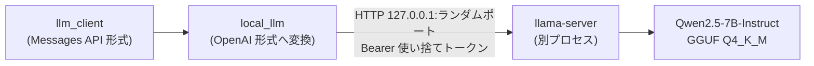

# ローカル LLM(Qwen 2.5 7B)

端末内で動く LLM。Claude(Anthropic / Bedrock)と同じ用途(対話とツール使用、校正、整理バッチ、スキルの選定、会話の要約)に選べる。実装は `services/local_llm.rs`(取得・起動・形式の変換)と `commands/local_llm.rs`(画面からの取得・削除)。

## 構成

- 推論は llama.cpp の `llama-server` を別プロセスで起動して行う。whisper-rs が whisper.cpp(ggml)を静的リンクしているため、版の違う ggml を同じプロセスへ入れない。
- プロバイダーは `Provider::Local`(`"local"`)。モデル ID は `qwen2.5-7b-instruct`、表示名は `Qwen 2.5 7B (Local)`。
- `llm_client::complete` / `complete_cached` / `complete_with_tools` は、`Local` のとき `local_llm` へ渡す。呼び出し側(`tool_loop.rs`、`compact.rs`、`batch.rs`、`proofread.rs`、`skills.rs`)は変えていない。

## 取得(設定画面の「AI Link」)

| 取得物 | 取得元 | 検証 |
| --- | --- | --- |
| llama.cpp `b12110`(v0.9.0)の `llama-b12110-bin-macos-arm64.tar.gz`(約16MB。llama-server と dylib) | GitHub(`ggml-org/llama.cpp` のリリース) | サイズと SHA-256 |
| `qwen2.5-7b-instruct-q4_k_m-00001-of-00002.gguf`(約3.99GB)と `-00002-of-00002.gguf`(約690MB) | Hugging Face(`Qwen/Qwen2.5-7B-Instruct-GGUF`、リビジョン固定) | サイズと SHA-256 |

- 版・リビジョン・SHA-256・サイズは `local_llm.rs` の定数に固定し、画面からは変えられない。一致しないファイルは破棄する(`checksum_mismatch`)。
- 置き場所はアプリデータの `llm/`(`bin/`、`models/`、`installed.json`、`server.log`)。全ワークスペースで共通。
- 各ファイルは `.part` へ保存し、検証してから置き換える。`installed.json`(版とリビジョン)は全部が揃ってから書くため、途中で失敗したものは未取得として扱う。
- 取得済みのモデル(サイズが一致するもの)は取り直さない。llama-server は毎回取り直す。
- 進み具合は `Channel` で画面へ流す(8MB ごと)。中断すると取得途中のファイルは消える(`download_cancelled`)。
- 削除すると、サーバーを止めてから `llm/` を丸ごと消す。

## 使えるかどうか

- `Secrets::has_key(Provider::Local)` は、キーではなく取得済みかどうか(`local_llm::installed()`)を返す。これにより、モデル一覧・保存済みの選択の検証・チャット画面の案内は、ほかのプロバイダーと同じ処理で扱える。
- カタログ(`llm_router::catalog`)では、取得済みのときだけ末尾に並ぶ。既定のモデル(対話は Sonnet、スキル選定は Haiku)は従来どおり Claude を優先し、Claude が使えないときだけローカルが既定になる。
- キーの保存・削除・疎通確認・リーダーへのコピーの対象外(`invalid_provider`)。

## サーバーの起動と停止

- 最初の要求のときに起動する。モデルの読み込みを `/health` が 200 を返すまで待つ(最大 180 秒)。
- 起動の引数: `--host 127.0.0.1 --port <空きポート> --ctx-size 32768 --n-gpu-layers 999 --parallel 1 --jinja`。`--jinja` により、Qwen 2.5 のツール呼び出しの形式はサーバー側が解釈する。
- 要求は 1 つずつ処理する(サーバーのロックを応答まで持つ)。推論中に来た要求は前の要求を待つ。
- 呼び出し側が中断(`task_cancel`)すると接続が切れ、サーバー側の生成も止まる。
- 応答の待ち時間は 300 秒、応答の上限は対話 8192 トークン、それ以外 4096 トークン。
- アプリの終了時に止める。異常終了で残った場合に備えて PID を `llm/server.pid` に書き、次の起動時にプロセス名が `llama-server` なら止める。

## 形式の変換

| Messages API | OpenAI 形式 |
| --- | --- |
| `system`(固定部分 + 可変部分) | 先頭の `role: system`(連結。キャッシュ点は付けない) |
| `assistant` の `tool_use` ブロック | `tool_calls`(`arguments` は JSON 文字列) |
| `user` の `tool_result` ブロック | `role: tool` のメッセージ(`is_error` は本文の先頭に `Error:`) |
| `thinking`・サーバーツールのブロック | 渡さない(Claude で実行した分の履歴) |
| ツール定義 `input_schema` | `function.parameters`。`input_schema` の無いサーバーツールは除く |
| `finish_reason: tool_calls` / `length` / その他 | `stop_reason: tool_use` / `max_tokens` / `end_turn` |

- 応答の `tool_calls` に ID が無ければ作る。引数が壊れた JSON なら空の入力にし、ツール側のエラーからモデルに直させる。

## セキュリティ

- 待ち受けは `127.0.0.1` のみ。起動ごとに使い捨てのトークンを作り(UUID v4 を 2 つ連結)、メモリにだけ持つ。トークンは引数ではなく環境変数 `LLAMA_API_KEY` で渡す(引数は `ps` でほかのユーザーから見えるため)。
- 起動後、トークンなしの要求が `401` になることを確かめ、受け付けてしまうサーバーは使わない。
- 取得物は版と SHA-256 を固定して検証する([security.md](security.md))。
- llama-server はアプリと同じユーザー権限で動く。別プロセスにしても、同じユーザーのファイル(`secrets.json` など)を読めないわけではない。分離の効果はクラッシュとメモリに限られる。

## 決定事項

- モデルは Qwen2.5-7B-Instruct のみ。3B は Qwen Research License(非商用)のため扱わない。7B は Apache 2.0。
- llama-server は同梱せず、実行時に取得する(VOICEVOX と同じ運用)。ビルドと CI に手順を足さないため。
- Web 検索・ページ取得(Anthropic のサーバーツール)は使えない。ファイル操作・コマンド実行(承認付き)・スキルのツールは Claude と同じものを渡す。

## 既知の限界

- 一度起動したサーバーは、アプリの終了か削除・取り直しまで動き続ける(メモリを約 5GB 以上使う)。
- 小さいモデルのため、Claude よりツールの使い方・日本語の応答の質が落ちることがある。ツールの数・システムプロンプトは Claude と同じものを渡している。
- 要求を 1 つずつ処理するため、整理バッチの実行中は対話の応答が遅れる。
- macOS(Apple Silicon)専用。取得するのは arm64 版だけ。
