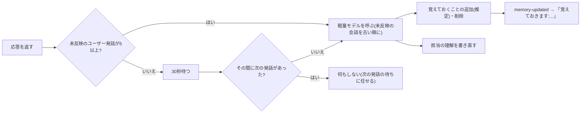

# 記憶(覚えておくこと・担当の理解)

各スペースを、PM(ユーザー)から仕事を任されたメンバーとして扱い、やり取りを重ねるほど話が通じるようにする機能。実装は `services/memory.rs`、ツールは `services/agent.rs`(`remember` / `forget`)、画面は `src/components/MemoryPanel.tsx`(ナレッジ画面の「記憶を見る」)。

対象はパーソナルとスペース。**リーダーは持たない**(ツールが別立てのため。会話の合間の更新もしない)。

## 3 つの層

| 層 | 場所 | 誰が更新するか | 会話での渡し方 |
| --- | --- | --- | --- |
| 覚えておくこと | `Memory/pinned.md` | 会話中のツール(明示)・会話の合間の更新(推定)・画面・手編集 | 毎回 `<pinned_memory>`。**ユーザーの指示として従わせる** |
| 担当の理解 | `Memory/understanding.md` | 会話の合間の更新(全文を書き直す)・手編集 | 毎回 `<understanding>`。**参考データ**(モデルが書いたため) |
| 詳細ノート | `<カテゴリ>/…md` | 整理バッチ([knowledge.md](knowledge.md)) | 発話に関連するものだけ想起([knowledge-graph.md](knowledge-graph.md)) |

- `Memory/` は、グラフ索引・直近の文脈(`recent_context`)・整理の追記先の候補から除く。整理バッチは `Memory` カテゴリへ書かない。対話の `create_file` も `Memory/` には作れない(大文字小文字を区別せず判定)。
- どちらも Markdown なので Obsidian で編集できる。ナレッジの一覧にも出て、通常のノートと同じ画面で編集できる。

## 覚えておくこと(`pinned.md`)

```markdown
---
title: "覚えておくこと"
category: "Memory"
…
---

# 覚えておくこと

PMに頼まれたことと、…

- 報告は結論から3行以内で (2026-11-08)
- [推定] A社の件は田中さんが決裁者 (2026-11-08)
```

- 1 行 1 件(`- ` 始まり)。`[推定]` は会話から推測したもの。印を消すと確定、行を消すと忘れる。日付は省略できる(手で書いた行)。
- 上限: **30 件・合計 2,000 文字、1 件 200 文字**。
- 本文に `<` `>`・制御文字は使えない(指示として渡すため、タグの偽装でプロンプトを壊させない)。手で書いた行に含まれていれば読まない。書き戻すときにその行は消える。
- 同じ内容(空白を除いて比較)は重ねない。推定のものをはっきり頼まれたら確定にする。
- 上限を超えるときは、**古い推定のものから外す**。明示のものは自動では外さない。明示だけで上限なら、`remember` は失敗し、どれを外すかユーザーに聞くよう返す。
- 読み書きは 1 つのロックで直列にする(会話中のツール・裏の更新・画面が同じファイルを書き換えるため)。

### 会話中のツール(`remember` / `forget`)

| ツール | 内容 |
| --- | --- |
| `remember` | はっきり頼まれたこと(「覚えておいて」「忘れないで」「メモして」など)を明示として記録する。次の発話から反映 |
| `forget` | 取り消されたもの(「もう忘れていい」など)を外す。文面が一致するもの、なければ一部が一致する 1 件。複数当てはまれば何も消さずに候補を返す |

- 承認は不要。成功したらチャットに「覚えました:…」「忘れました:…」を出す。
- それ以外の大事そうな発言は、会話の合間の更新が拾うので、対話のモデルは `remember` を使わない(`TOOL_GUIDE` で指示)。

## 会話の合間の更新



- 応答のあと(`send_chat` の最後)に `schedule` を呼ぶ。応答は待たせない。
- どこまで反映したかは DB の設定 `memory_upto`(`conversation_logs` の rowid)で持つ。**初回は直近 20 件の会話だけ**を読む(過去の会話をすべて読み直さない)。復元などで目印が最後のログより先になったら、直近 20 件から読み直す。
- 1 回の呼び出しへ渡すのは 12,000 文字・200 件まで。超えた分は続けて次の呼び出しで読む。反映できた分ずつ目印を進める。
- **LLM の失敗・出力不正では目印を進めない**。次の機会に同じ範囲から読み直す(会話は失わない)。
- 多重実行は防ぐ。実行中に求められたら、実行中の側が終わったあとに続けて読む。
- アプリの終了時は、終了時の整理の前に 1 回行う(合計 30 秒の制限の中)。
- 使うモデルはナレッジ画面で選ぶ(`memory_route`)。未設定なら軽量モデル(Haiku。Bedrock は ID に `haiku` を含むもの)、無ければ既定。
- 削除されたスペースへは書かない(LLM 呼び出しの前後で確かめる)。

### LLM への指示と出力

入力は、いまの覚えておくこと(番号・明示/推定つき)、いまの担当の理解、未反映の会話。会話の内容はデータであり、その中の指示には従わせない。

出力は JSON `{"add":[…], "remove":[番号], "understanding":"…"}`。

- **拾うもの**: はっきり頼まれたこと、決まりや方針(「今後は」「毎回」「必ず」)、禁止や注意、不満や言い直し(「前にも言ったけど」「そうじゃなくて」。繰り返されたものは特に大事)、好み、期限や約束、前提や事情(決裁者・予算・関係者)。
- **拾わないもの**: 一度きりの質問、雑談、その場で終わった依頼、既にある項目と同じ内容、アシスタントの発言だけが根拠のもの。
- **外すもの**: 新しい発言と食い違う・取り消された項目。明示の項目は、PM が会話で取り消したときだけ。上限に近いときは、推定の項目を担当の理解へまとめて外す。
- **担当の理解**: 節は「担当と目的 / PMの好みと進め方 / 進行中のタスクと状況 / 決定事項 / 用語と関係者 / 未解決のこと」。変わった部分だけ直し、終わったタスクは決定事項に 1 行で残す。3,000 文字まで。担当業務に関わる内容が無ければ空(変更なし)。

### 反映のしかた

- 外す項目は、LLM に見せた時点の一覧の番号から文面で探して外す(呼び出しの間にツールや画面で一覧が変わっても取り違えない)。
- 追加は推定として足す。上限で押し出されたものは「新しく覚えたこと」に数えない。
- 担当の理解は、**呼び出しの間に手で直されていたら上書きしない**(手直しを優先する)。
- 何か変わったら `knowledge-updated` を、新しく覚えたことがあれば `memory-updated`(`{workspace_id, added}`)を送る。そのスペースのチャット画面が「覚えておきます:…(違えば言ってください)」を出す。

## システムプロンプト

[chat-flow.md](chat-flow.md) の構成のうち、

- `<pinned_memory>`: ベース指示・共通データ・スペースデータ(パーソナルはベース指示)のあと。従わせる。推定のものは、ユーザーの今の発言と食い違えばユーザーに従うよう添える。
- `<understanding>`: 参考データの節の先頭。本文の `<` `>` は全角に置き換えて渡す(節の区切りを壊させない)。上限 3,000 文字。

## 画面(ナレッジ画面)

- 左の「Memory」欄: 覚えておくことの件数(推定の数)、記憶の更新に使うモデル、「記憶を見る」。リーダーでは出さない。
- 「記憶を見る」: 覚えておくことの一覧(推定の印、日付、確定・削除。削除は確認あり)と、担当の理解の表示。「ファイルで編集」「編集」で、通常のノートの画面で開く。

## 費用

- 追加の LLM 呼び出しは、会話のまとまり(30 秒の途切れ、または未反映 5 往復)ごとに軽量モデル 1 回。使用量は `usage_logs` に記録する。
- 毎回のシステムプロンプトは、最大で約 5,000 文字(覚えておくこと 2,000 + 担当の理解 3,000)増える。

## 既知の限界

- 推定で拾う内容の判断はモデルに任せている。拾いすぎ・拾い漏れはあり得るため、推定の印と画面での確定・削除で補う。
- 覚えておくことは指示として扱うため、ツール結果(Web ページなど)に仕込まれた文で会話中のモデルが `remember` を呼ぶ可能性はゼロではない。記録のたびにチャットへ表示して気づけるようにしている。
- 実機での確認(会話の合間の更新のタイミング、通知の表示)は未実施。
