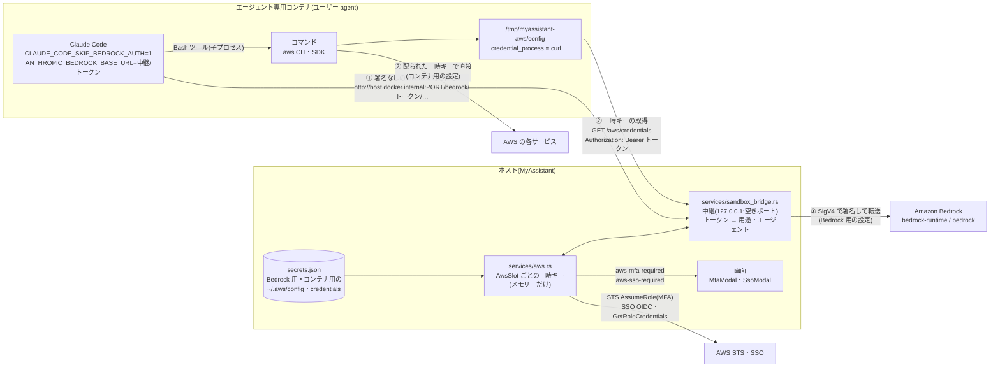
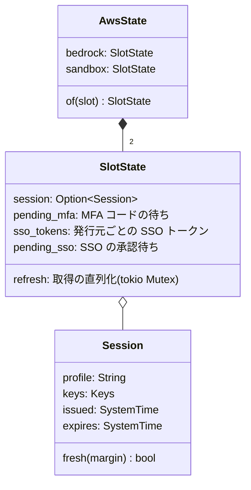
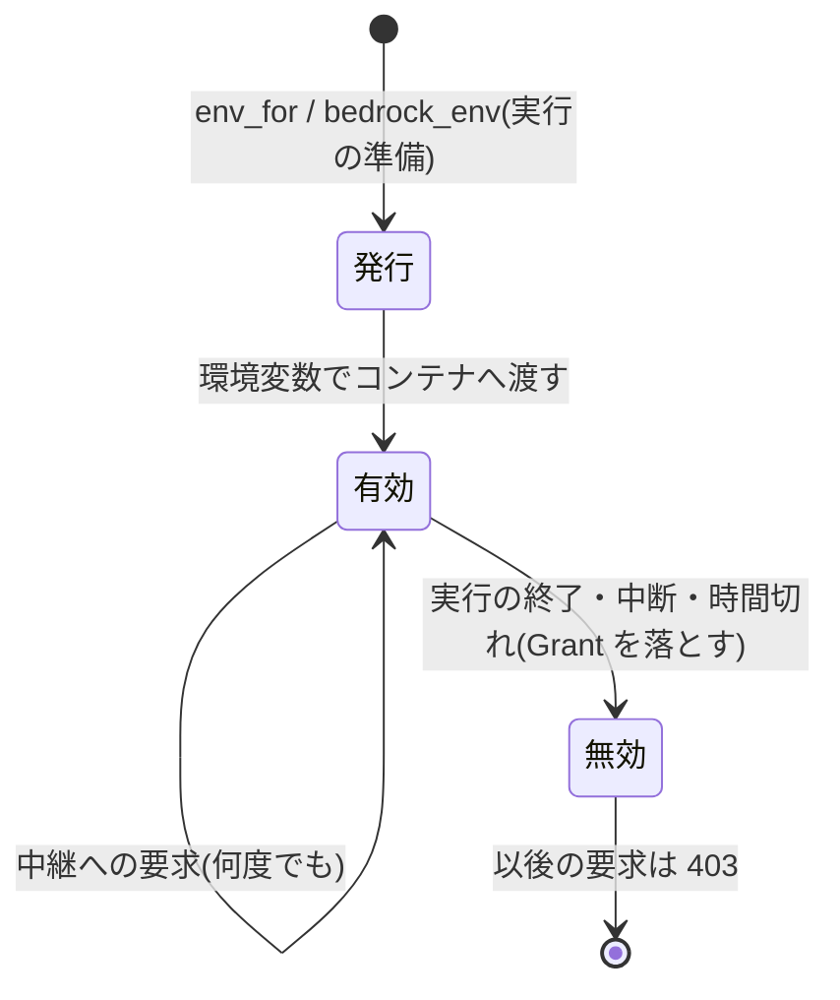
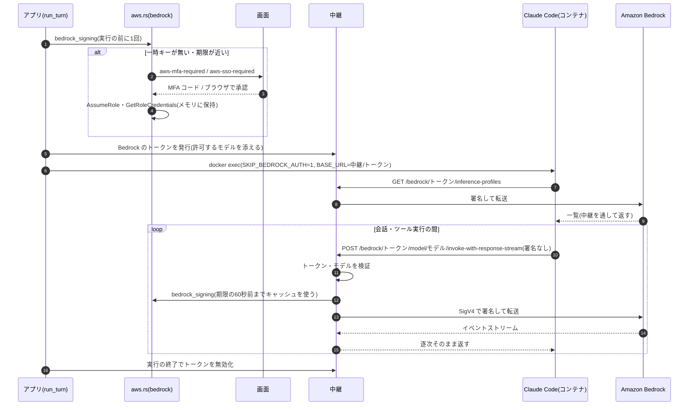
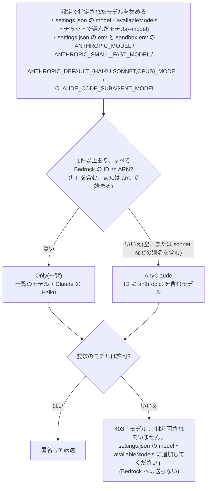
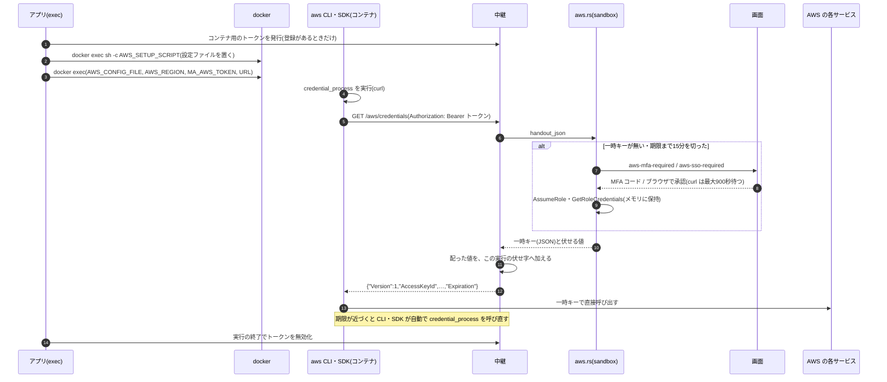

# サンドボックスの AWS 認証(ホストの中継)

サンドボックス(エージェント専用のコンテナで Claude Code を動かす機能。[sandbox.md](sandbox.md))が AWS を使うときの、認証情報の扱いをまとめる。AWS の認証情報は2つあり、どちらもコンテナへ直接は渡さない。

| 用途 | 使う人 | 登録する場所 | コンテナへの渡し方 |
| --- | --- | --- | --- |
| **Bedrock 用** | コンテナ内の Claude Code(LLM の呼び出し) | AI Link の Amazon Bedrock | 渡さない。ホストの中継が代わりに署名して転送する |
| **コンテナ用** | コンテナ内のコマンド(`aws` CLI・AWS SDK) | Sandbox タブの詳細設定「コンテナ内の AWS」 | 一時キーだけ。コマンドが使うときに、ホストの中継から取りに来る |

実装: `services/sandbox_bridge.rs`(中継)、`services/aws.rs`(2つの設定の認証)、`services/secrets.rs`(`AwsSlot` と保存先)、`services/sandbox.rs`(`env_for`・`exec`)、`services/sandbox_agent.rs`(`run_turn`)、`commands/aws.rs`。画面は `AwsPanel`(`slot`)、`MfaModal`、`SsoModal`、`SandboxPanel`。

## 目的と要件

- Bedrock を呼ぶ認証情報と、コンテナ内で AWS へ接続する認証情報を分ける(別のアカウント・ロールを使えるようにする)。
- どちらの認証情報も、スイッチロールの MFA(`mfa_serial`)と IAM Identity Center(SSO)に対応する。認証は従来どおりホスト(このアプリ)で行う。
- **Bedrock 用の認証情報は、コンテナ内のコマンドから使えないようにする。** コマンドから値が見えたうえで使えないように制御することはできない(下記)ため、値そのものをコンテナへ入れない。
- コンテナ用の認証情報が登録されていなければ、コンテナへ AWS の認証情報を何も渡さない(Bedrock 用で代用しない)。
- 一時キーの期限が切れても、長い処理が途中で止まらないようにする。

### 値をコンテナへ入れない理由

AWS のアクセスキーは、値を知っていれば誰でも使える(持参人型の)認証情報である。Claude Code の Bash ツールで動くコマンドは、Claude Code の子プロセスとして同じユーザー(`agent`)で動くため、Claude Code が持つ環境変数・ファイル・メモリはすべてコマンドからも読める(`/proc/<pid>/environ` など)。このため「Claude Code には渡すが、コマンドには使わせない」は実現できない。値をコンテナの外(ホスト)に置き、署名だけをホストで行う。

## 全体構成



- ① Bedrock: Claude Code は署名せずに中継へ送り、中継が Bedrock 用の一時キーで署名して Bedrock へ転送する。コンテナには Bedrock 用のキーが一切入らない。
- ② コンテナ用: AWS CLI・SDK は `credential_process` で中継から一時キーを取り、それを使って AWS へ直接接続する。コンテナに入るのはコンテナ用の一時キーだけ(元のアクセスキーや SSO のトークンは入らない)。
- MFA の入力と SSO の承認は、どちらの用途もホストの画面で行う。

## 2つの AWS 設定(`AwsSlot`)

`secrets::AwsSlot` で用途を区別する。`bedrock` は以前からの設定(保存先の名前も以前のまま)、`sandbox` は新しく加えた設定。

| 項目 | `bedrock` | `sandbox` |
| --- | --- | --- |
| `~/.aws/config` の本文 | `aws_config` | `sandbox_aws_config` |
| `~/.aws/credentials` の本文 | `aws_credentials` | `sandbox_aws_credentials` |
| 使うプロファイル | `aws_profile` | `sandbox_aws_profile` |
| 保存先 | ワークスペースの `secrets.json`(エージェントごと) | 同左 |
| 画面 | LLM タブの AI Link(Amazon Bedrock) | Sandbox タブの詳細設定「コンテナ内の AWS」 |
| 削除 | `delete_api_key("bedrock")` または `delete_aws_config` | `delete_aws_config` |
| エラーの出どころ(`source`) | `bedrock` | `sandbox_aws`(画面の表示は「Sandbox AWS」) |

- 対応する認証方式は両方とも同じ(アクセスキー、SSO、それらを `source_profile` にした1段のロール。MFA 付きのロールを含む。[security.md](security.md#aws-認証awsrs))。
- 一時状態(`AwsState`。ワークスペースの共有状態 `shared.aws`)は用途ごとに別々に持つ。一方の MFA 入力・SSO 承認・一時キーは、もう一方に影響しない(同じ SSO の発行元でも、承認は用途ごとに1回ずつ要る)。



- 設定のコピー(キーを含める)は `secrets.json` をまとめて写すので、両方の用途が写る。写したあとは `aws::reset_all` で両方の一時状態を捨てる。
- バックアップには `secrets.json` ごと含まれる(平文。[backup.md](backup.md))。

## 中継(`sandbox_bridge`)

### 待ち受け

- ホストの `127.0.0.1` の空いているポートで、HTTP/1.1 を待ち受ける(hyper)。最初に使うとき(最初の実行の準備)に起動し、アプリの終了まで動かす。
- コンテナからは `host.docker.internal:<ポート>` で届く(Docker Desktop が、ホストのループバックへ転送する)。LAN には公開しない。
- 起動時に `sandbox_bridge::init` で `AppHandle` を控え、トークンに結びついたエージェントのワークスペースを `Workspaces::resolve` で開く。

### トークン

- 実行(`docker exec` 1回)ごとに、用途ごとのランダムなトークン(UUID v4 を2つつないだ 64 桁の16進数)を発行する。トークンは `Grant` として実行の間だけ持ち、**実行が終わる(`Grant` を落とす)と無効になる**。
- トークンは、そのエージェントと用途(Bedrock かコンテナ用か)に結びつく。Bedrock のトークンではコンテナ用の一時キーを取れず、その逆もできない。



### 受け付ける要求

それ以外のパス・メソッドは 404。

| メソッドとパス | 用途 | 処理 |
| --- | --- | --- |
| `POST /bedrock/<トークン>/model/<モデル>/invoke` | Bedrock | 署名して `https://bedrock-runtime.<リージョン>.amazonaws.com/model/<モデル>/invoke` へ転送 |
| `POST /bedrock/<トークン>/model/<モデル>/invoke-with-response-stream` | Bedrock | 同上(応答はイベントストリームを逐次そのまま返す) |
| `POST /bedrock/<トークン>/model/<モデル>/count-tokens` | Bedrock | 同上 |
| `GET /bedrock/<トークン>/inference-profiles?<クエリ>` | Bedrock | 署名して `https://bedrock.<リージョン>.amazonaws.com/inference-profiles` へ転送(Claude Code が起動時に呼ぶ推論プロファイルの一覧。読み取りだけ) |
| `GET /aws/credentials`(`Authorization: Bearer <トークン>`) | コンテナ用 | `credential_process` の形式の JSON で一時キーを返す |

- モデルはパスの1区間として届く(推論プロファイル ID の `:` はそのまま、ARN の `/` は `%2F`)。復号してから検証し(空・512 文字超・空白や制御文字は拒否)、転送先の URL では英数字と `-._~` 以外を符号化し直す。
- 転送先のホストは、Bedrock 用のプロファイルのリージョン(英小文字・数字・`-` だけを許す)からだけ組み立てる。コンテナからはホストを指定できない。
- クエリは英数字と `=&_-.%` だけ、512 文字までを許す。
- 本文は 64MB まで。
- コンテナから受け取ったヘッダーのうち、Bedrock へ渡すのは `content-type`・`accept`・`anthropic-*`・`x-amzn-bedrock-*` だけ(`authorization`・`host` などは渡さない)。
- Bedrock の応答のうち、コンテナへ返すヘッダーは `content-type`・`x-amzn-requestid`・`x-amzn-errortype` だけ。

## Bedrock の流れ



- **実行の前に認証を済ませる**: `bedrock_env` は、トークンを発行する前に Bedrock 用の一時キーを1回取る。MFA の入力や SSO の承認は、Claude Code を起動する前に求める(以前と同じ使い勝手。Claude Code の要求の待ち時間の中で承認を待たない)。Bedrock 用の設定が無ければ、ここで「Bedrock の認証情報がありません」のエラーにして実行しない。
- **一時キーの期限切れ**: 中継は要求ごとに `bedrock_signing` を呼ぶ。キャッシュした一時キーは期限の 60 秒前まで使い、それより後は取り直す(MFA のプロファイルなら、そこで MFA を求める)。Bedrock が `ExpiredToken` を返したときは、一時キーを捨てる。Claude Code は失敗した要求を再送するので、次の要求で取り直した一時キーが使われる。
- 署名は `aws-sigv4`(サービス名 `bedrock`)。署名するヘッダーは `host` と `content-type`、本文のハッシュを含める。転送は、そのエージェントのプロキシの設定(`proxy::client_builder_for`)に従う([proxy.md](proxy.md))。接続の待ちは 20 秒で、応答全体の時間は区切らない(長いストリーム)。

### 許可するモデル(`ModelPolicy`)

中継は、設定で指定したモデルだけを通す。コンテナ内のコマンドがトークンを読んで中継を使っても、呼べるのはこのモデルだけ。



- Claude の Haiku 系(ID に `anthropic.` と `haiku` を含む)は、一覧に無くても通す。Claude Code が補助の処理(要約など)に既定の Haiku を使うことがあり、止めると Claude Code の機能が壊れるため(2026-11-13 に決定)。
- 別名(`sonnet`・`opus` など)は Claude Code が Bedrock の ID に直してから送るため、中継では一覧と照合できない。このときは Claude のモデルならすべて通す。

## コンテナ用の AWS の流れ



- **使うときに取りに来る**: 実行の準備では一時キーを取らない。コマンドが AWS を使うときに初めて取りに来るので、AWS を使わない指示で MFA を求めることはない。
- **期限の前に取り直す**: AWS CLI(botocore)と SDK は、期限の 15 分前から `credential_process` を呼び直す。これに合わせ、中継は期限まで 15 分を切った一時キーを配らず取り直す。ただし有効期間の半分を超えては早めない(例: 15 分のセッションは、残り 7.5 分までは同じものを配る。取得のたびに取り直すことを避ける)。下限は 60 秒。
- アクセスキーをそのまま使うプロファイル(ロールも SSO も使わない)は、期限を付けずにそのキーを配る。
- 登録が無いときは、トークンも設定ファイルも作らず、`AWS_*` も渡さない。`sandbox.env` に書いたものだけが渡る。
- `sandbox.env` に `AWS_ACCESS_KEY_ID` などを書いた場合は、AWS CLI・SDK の決まりにより環境変数のキーが `credential_process` より優先される(`sandbox.env` が最優先という従来の決まりのまま)。

### 一時キーの期限と取り直し

| 用途 | 取り直す時点 | 取り直す契機 |
| --- | --- | --- |
| Bedrock(中継の署名) | 期限の 60 秒前 | 中継への要求のたび。`ExpiredToken` を受けたら捨てる |
| コンテナ用(配る一時キー) | 期限の 15 分前(有効期間の半分まで。下限 60 秒) | CLI・SDK の `credential_process` |
| 接続テスト(両方) | 期限の 60 秒前 | 画面の「接続テスト」 |

### コンテナ内の設定ファイル

`exec` は、コンテナ用のトークンがある実行の直前に、短い `docker exec` を1回行って次のファイルを置く(`/tmp` はコンテナの tmpfs。アトミックに置き換える。権限は `umask 077`)。内容は固定で、トークンや URL は含まない(実行ごとの環境変数から読む)。

`/tmp/myassistant-aws/config`:

```ini
[default]
credential_process = sh -c 'out=$(curl -sS --max-time 900 --fail-with-body -H "Authorization: Bearer $MA_AWS_TOKEN" "$MYASSISTANT_AWS_CREDENTIALS_URL") || { echo "MyAssistant: $out" >&2; exit 1; }; printf "%s" "$out"'
```

- `/tmp/myassistant-aws/credentials` は空のファイルにする。`~/.aws/credentials`(専用ボリューム)にキーがあっても混ざらない。
- 取得に失敗したときは、中継が返した理由を標準エラーへ出す。CLI・SDK はそれをエラーの文面に含める(例: `MyAssistant: {"message":"コンテナ用の AWS 認証情報を取得できませんでした: …"}`)。
- AWS の SDK が標準で持つ「コンテナの資格情報のエンドポイント」(`AWS_CONTAINER_CREDENTIALS_FULL_URI`)は使わない。SDK は、http の URL をループバック(`127.0.0.1`)か ECS・EKS の固定アドレス宛てにしか許さず、`host.docker.internal` を拒否するため。
- イメージに `curl` が必要(標準の Dockerfile には入っている)。

## 渡す環境変数

| 名前 | 値 | 用途 | 秘密か(出力で伏せるか) |
| --- | --- | --- | --- |
| `CLAUDE_CODE_USE_BEDROCK` | `1` | Bedrock | いいえ |
| `CLAUDE_CODE_SKIP_BEDROCK_AUTH` | `1`(Claude Code は署名しない) | Bedrock | いいえ |
| `ANTHROPIC_BEDROCK_BASE_URL` | `http://host.docker.internal:<ポート>/bedrock/<トークン>` | Bedrock | はい(トークンを含む) |
| `AWS_CONFIG_FILE` | `/tmp/myassistant-aws/config` | コンテナ用 | はい(8 文字以上なので対象。秘密ではない) |
| `AWS_SHARED_CREDENTIALS_FILE` | `/tmp/myassistant-aws/credentials` | コンテナ用 | 同上 |
| `AWS_REGION` / `AWS_DEFAULT_REGION` | コンテナ用のプロファイルのリージョン | コンテナ用 | いいえ(`*REGION`) |
| `MA_AWS_TOKEN` | コンテナ用のトークン | コンテナ用 | はい |
| `MYASSISTANT_AWS_CREDENTIALS_URL` | `http://host.docker.internal:<ポート>/aws/credentials` | コンテナ用 | いいえ(`MYASSISTANT_`) |

- 重ねる順は、アプリが決める値(`CLAUDE_CODE_USE_BEDROCK`)→ Bedrock の中継 → コンテナ用の中継 → `sandbox.env`。同じ名前は後のものが優先(`sandbox.env` が最優先)。
- Claude Code は `ANTHROPIC_BEDROCK_BASE_URL` を使うため、`AWS_REGION` を Bedrock の呼び出しには使わない。`AWS_REGION` はコンテナ用のリージョンだけを表す。
- Bedrock 用の認証情報(キー・リージョン)は、どの名前でもコンテナへ渡らない。
- コマンドだけを実行するとき(`sandbox::run`。Claude Code を使わない)は、Bedrock の中継を渡さず、コンテナ用だけを渡す。

## 出力の伏せ字

- 環境変数の値(上の表の「はい」と `sandbox.env`)は、従来どおり出力に出たら `***` に置き換える(8 文字以上)。
- コンテナ用の一時キーは環境変数に無いため、**中継が配った値(アクセスキー ID・シークレット・セッショントークン)をその実行の伏せ字に加える**。`Grant` が配った値を持ち、`exec` は出力を受けるたびに、新しく配られた値があれば伏せ字(`Masker::add`)へ加える。中継は値を配る前に記録するので、コマンドがキーを出力する前に伏せ字へ入っている。
- 変形した値(Base64 など)は検知できない(従来どおり)。

## 画面

- **AI Link の Amazon Bedrock**(`AwsPanel slot="bedrock"`): 以前のまま。
- **Sandbox タブ → 詳細設定 → コンテナ内の AWS**(`AwsPanel slot="sandbox"`): 同じ貼り付けフォーム・プロファイルの選択・接続テスト・削除・一時認証の期限の表示。「使用中の機能」は出さない。
- **MFA・SSO の入力画面**(`MfaModal`・`SsoModal`): 要求に `slot` を持つ。コンテナ用のときは「コンテナ内のコマンド用のAWS設定です。」と添える。同じエージェントの Bedrock 用とコンテナ用の要求は、別々に並べる(待ち行列の区別は「ワークスペース ID と用途」の組)。入力・取り消し・ブラウザを開く操作は、要求の `slot` へ返す。
- Sandbox タブの説明: Bedrock の認証情報はコンテナへ渡さないこと、コンテナ内の AWS は別に登録することを示す。

## コマンドとイベント

| コマンド | 内容 |
| --- | --- |
| `get_aws_status(slot?)` | 登録有無・プロファイル一覧・選択・一時キーの期限(キーは返さない) |
| `get_aws_files(slot?)` | 保存済みの本文(本人が確認・編集するためだけ。[security.md](security.md)) |
| `preview_aws_config` | 貼り付け中の内容のプロファイル一覧(用途に依らない) |
| `save_aws_config(slot?, …)` / `select_aws_profile(slot?, name)` | 保存・選択。その用途の一時状態を捨てる |
| `delete_aws_config(slot?)` | その用途の設定を消す(新設) |
| `test_aws_connection(slot?)` | STS の `GetCallerIdentity` で認証を確かめる |
| `submit_aws_mfa` / `cancel_aws_mfa` / `open_aws_sso` / `cancel_aws_sso`(`workspace_id`, `slot?`) | 要求したワークスペースと用途へ返す |

- `slot` は `bedrock` / `sandbox`。省略すると `bedrock`(以前の呼び出しと同じ)。
- イベント `aws-mfa-required`・`aws-sso-required` のペイロードに `slot` を加えた。`aws-sso-finished` のペイロードは、ワークスペース ID の文字列から `{ workspace_id, slot }` に変えた。

## エラー

| 状況 | 結果 |
| --- | --- |
| Bedrock 用の設定が無い | 実行しない。「Bedrock の認証情報がありません。このエージェントに Amazon Bedrock の AWS 設定を登録してください。」 |
| Bedrock 用の認証に失敗(MFA を入力しない・SSO を承認しないなど) | 実行しない。「Bedrock の認証情報を取得できませんでした: …」 |
| コンテナ用の設定はあるが、選んだプロファイルが使えない | 実行しない。「コンテナ用の AWS 設定で、使うプロファイルが選ばれていないか、使えない状態です。…」 |
| コンテナ用の設定ファイルを置けない | 実行しない。「コンテナ用の AWS 設定を準備できませんでした: …」 |
| 実行中のコンテナ用の取得の失敗 | そのコマンドだけが失敗する(CLI・SDK のエラーに中継の理由が入る) |
| 許可していないモデル・無効なトークン | 中継が 403(JSON の `message`)。Bedrock へは送らない |

## 決定事項

- Bedrock 用の認証情報はコンテナへ渡さず、ホストの中継で署名する(2026-11-13 に決定)。Claude Code の `CLAUDE_CODE_SKIP_BEDROCK_AUTH` と `ANTHROPIC_BEDROCK_BASE_URL` を使う。
- 中継のトークンが実行中にコマンドから読めること(下の既知の限界)は受け入れる(2026-11-13 に決定)。
- コンテナ用の認証情報は、実行の開始時に渡すのではなく、`credential_process` でホストから取りに来る方式にする(期限切れで長い処理が止まらないため。2026-11-13 に決定)。[sandbox.md](sandbox.md) の後回しにした項目 5 を、この方式で実装した。
- コンテナ用の設定が無ければ、AWS の認証情報は渡さない(Bedrock 用で代用しない。2026-11-13 に決定)。
- `sandbox.env` に書いた AWS のキーは、コンテナ内のコマンドにだけ効く。Bedrock には使わない(Bedrock は AI Link の設定だけ。2026-11-13 に決定)。
- 許可するモデルに、Claude の Haiku 系を含める(上記。2026-11-13 に決定)。

## 既知の限界

- **Claude Code の実行中は、コンテナ内のコマンドも Bedrock の中継を使える。** トークンは Claude Code の環境変数にあり、子プロセスであるコマンドからも読めるため。ただし呼べるのは許可したモデルの呼び出しと推論プロファイルの一覧だけで、Bedrock 用のキーを持ち出すことや、Bedrock 用のアカウントで他の AWS 操作をすることはできない。実行が終われば使えない。これを塞ぐには、コマンドから中継への通信を止める(Claude Code の Bash ツール用サンドボックスで通信先を制限するなど)必要があるが、コンテナの中では特権が要るなど動かない見込みが高いため、行っていない。
- 中継は、ホストの同じユーザーの別のプロセスからも届く(`127.0.0.1`)。有効なトークンが無ければ何もできない。
- コンテナから `host.docker.internal` でホストのループバックへ届くことを前提にしている(Docker Desktop で確認。ほかの実行環境は未確認)。届かない実行環境では、Bedrock もコンテナ用の AWS も使えない。
- イメージに `curl` が無いと、コンテナ用の AWS は使えない(Dockerfile を編集して消した場合など。コンテナの作成時の診断では確かめない)。
- 中継は、Bedrock へ要求のたびに新しい HTTP クライアントで接続する(TLS の接続を使い回さない)。
- 署名した一時キーで AWS が受け付けることは、実際の AWS 認証情報での確認が要る(自動テストは、ダミーのキーに AWS が `UnrecognizedClientException` を返すところまで)。

## 実機で確かめたこと(Claude Code 2.1.311)

- `ANTHROPIC_BEDROCK_BASE_URL` のパス(トークンを含む)を保ったまま、その後ろに `/model/<モデル>/invoke-with-response-stream` を付けて送る。モデル ID の `:` は符号化しない。
- 起動時に `GET <BASE_URL>/inference-profiles?type=SYSTEM_DEFINED` を呼ぶ。
- `CLAUDE_CODE_SKIP_BEDROCK_AUTH=1` で、署名のヘッダーを付けずに送る。送るヘッダーは `content-type`・`accept`・`anthropic-beta` など。
- 403 を受けると、間隔を空けて再送する(10 回近く。1 回の指示で数分かかる)。

## テスト

| テスト | 内容 | 実行 |
| --- | --- | --- |
| `sandbox_bridge::tests::routes_only_model_calls_profiles_and_credentials` ほか | 受け付けるパスの判定、許可するモデル、転送先の URL、渡すヘッダー、SigV4 の署名、設定ファイルの内容 | `cargo test` |
| `aws::tests::handout_*` | `credential_process` の JSON の形、取り直しの時点 | `cargo test` |
| `sandbox_agent::tests::bedrock_settings_are_required` / `configured_models_*` | Bedrock 用の設定が必須、モデルの集め方 | `cargo test` |
| `sandbox_bridge::tests::bridge_forwards_to_bedrock` | ダミーのキーで署名して実際の Bedrock へ転送し、AWS の認証エラーが返ること。許可していないモデルと無効なトークンを止めること | `cargo test -- --ignored bridge_forwards_to_bedrock`(ネットワーク) |
| `sandbox::tests::sandbox_aws_credentials_end_to_end` | 実際のコンテナで、未登録なら AWS の認証情報が無いこと、登録すると aws CLI が中継から一時キーを取ること、値が環境変数に無く出力では伏せられること、Bedrock 用のキーが見えないこと、実行の後はトークンが 403 になること | `cargo test -- --ignored sandbox_aws_credentials_end_to_end`(Docker・ビルド済みのイメージ) |
| `sandbox_agent::tests::claude_turn_end_to_end` | 実際のコンテナの Claude Code が中継経由で Bedrock を呼び、認証エラーの結果まで通ること | `cargo test -- --ignored claude_turn_end_to_end`(Docker・ネットワーク。再送のため約 9 分) |
