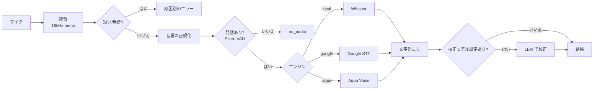

# 音声入力(録音・音声認識・校正)

マイク入力を文字にして、対話や承認の返答として使う。実装は `commands/voice.rs`(コマンド)、`services/audio.rs`(録音)、`services/vad.rs`(発話判定)、`services/stt*.rs`(認識)、`services/proofread.rs`(校正)。

## 処理の流れ

## 録音(`audio.rs`)

- `cpal` で既定の入力デバイスを開く。`Stream` が `Send` でないため専用スレッドで保持する。
- 複数チャンネルはモノラルへ平均化し、Whisper の要求する 16kHz へ線形補間でリサンプリングする。
- 上限は 120 秒(メモリの暴走防止)。
- **ウォームアップ**: 開始直後は厳密な 0(無音)しか届かないデバイスがある。実際に音が届くまで最大 2.5 秒待ってから「録音中」にする。冒頭が欠けないようにするため。起動直後のポップノイズは捨てる。
- 波形表示用に、直近約 100ms の入力を 128 点へ縮約して返す(`recording_waveform`)。
- 常時待機では、無音が溜まらないよう直近の一定時間だけ残して古い入力を捨てる(`trim_recording`)。

## 前処理と発話判定

`transcribe_recording` が、エンジンに渡す前に次を順に行う。

| 判定 | 内容 | エラー |
| --- | --- | --- |
| 短すぎる | 0.25 秒未満 | `too_short` |
| 信号なし | 最大振幅が厳密に 0 | `mic_no_signal`(マイクの権限・デバイスの問題) |
| 小さすぎる | 最大振幅が 0.004 以下 | `mic_too_quiet` |
| 正規化 | 小音量のマイク向けに最大 0.5 程度へ増幅(±1.0 にクリップ。無音・十分大きい入力は変更しない) | — |
| 発話判定(VAD) | Silero VAD。声がなければ以降へ回さない | `no_audio` |

- **VAD の目的**: 振幅では区別できない雑音(空調・打鍵・衣擦れ)を認識へ回さず、Whisper の幻聴(「ご視聴ありがとうございました」など無音への勝手な文字起こし)を防ぐ。判定は増幅後の音声で行う(声らしさを見るので、小音量のマイクでも取りこぼさない)。
- モデルはアプリに同梱する `ggml-silero-v5.1.2.bin`(`tauri.conf.json` の `bundle.resources`)。閾値 0.5、最短の有声区間 250ms(「はい」程度の短い返事は残る長さ)。初回のみロードして使い回す。
- VAD が使えない(モデルが無い等)場合は警告を出して、判定を省いて認識を続ける。
- 認識結果が空なら `no_audio`。

## 音声認識エンジン

設定画面で選ぶ(`stt_engine`、既定 `local`)。認識言語(`stt_language`: `auto` / `ja` / `en` / `zh` / `ko`)は共通。

| エンジン | 実行場所 | 必要なもの | 備考 |
| --- | --- | --- | --- |
| `local` | 端末内(whisper.cpp、Metal) | モデルファイル | 課金なし。ネットワーク不要 |
| `google` | Google Cloud Speech-to-Text(REST・同期) | Google Cloud API キー(Voice Link) | 約 1 分(58 秒)を超える録音は送らない |
| `aqua` | Aqua Voice API(Avalon `avalon-v1.5`) | Aqua Voice キー(Voice Link) | 認証は Google とは別のキー。60 秒のタイムアウト |

### ローカル Whisper(`stt.rs`)

- モデルは優先順に次のとおり。インストール済みのうち最も優先度の高いものを使う。

  | ファイル | サイズ | 備考 |
  | --- | --- | --- |
  | `ggml-large-v3-turbo-q5_0.bin` | 約 574MB | 優先。日本語の精度が高い量子化版 |
  | `ggml-small.bin` | 約 466MB | 下位。以前の既定 |

- ダウンロードは設定画面から行う(Hugging Face の `ggerganov/whisper.cpp`)。一時ファイルへ書いてからリネームし、途中で中断しても壊れたモデルを残さない。サイズの下限で破損・途中切れを検出する。優先モデルより下位しか入っていないときは更新を促す(`stt_model_upgradable`)。
- 取得するリビジョンは設定の「取得バージョン」で変えられる(`whisper_revision`、既定 `main`)。取得元は Hugging Face のままで、リビジョンには英数字と `. _ -` のみ使える。保存後にモデルを取得し直すと反映される。
- ビームサーチ幅は 3(精度と速度のバランス)。モデルのロードは重いため初回のみ。CPU 負荷が高いのでブロッキングスレッドで実行する。
- Whisper 内部の VAD にも同じパラメータを渡し、発話区間だけを認識する(発話後の無音に定型句を足す幻聴を防ぐ)。
- `[BLANK_AUDIO]`・`(音楽)` などの注釈と `♪` は除去する(`clean_transcript`)。
- **語彙ヒント(initial prompt)**: 起動ワード(有効時)と、訂正済みの用語(直近 8 件)を「、」でつないだ最大 100 文字のヒントを渡す。長すぎると無音で語彙を復唱する幻聴を招くため短く保つ。

### Google / Aqua

- Google: 16kHz mono を LINEAR16 にして送る。`auto` は日本語を主言語に英語を候補へ加え、自動句読点を有効にする。
- Aqua: 16bit PCM の WAV を multipart で送る。`auto` は API の自動判定に任せる。キー登録時は、無音の短い録音で認証だけを確かめる。

## 校正(`proofread.rs`)

文字起こし結果を、会話の文脈から LLM で直す補助ステップ。**既定ではオフ**で、設定の Proofread でモデルを選ぶと有効になる(`proofread_route`)。

- 渡すもの: 直近 6 件の会話(`<context>`)、訂正履歴(`<stt_corrections>`)、校正対象(`<transcript>`)。
- 指示: 同音異義語・固有名詞・専門用語の聞き間違い、誤変換、不自然な区切りだけを直す。言い換え・要約・補足・質問への回答はしない。直す箇所がなければそのまま返す。
- **校正は補助**: 失敗した、または結果が空・元の 3 倍(+20 文字)を超える(説明文が混ざったとみなす)ときは、元の文字列をそのまま返す。
- 軽量なモデル(Haiku や GPT-4o mini など)を選べば、コストと遅延を抑えられる。

## 聞き取り訂正

画面の字幕で、直前の発話を手で直して保存できる(`add_stt_correction`)。

1. 「聞き取った文」と「正しい文」の先頭・末尾の共通部分を除いた差分区間を「誤→正」として取り出す(`knowledge::add_correction`)。
2. `Preferences/stt_corrections.md` に、日付・元の文(例)とともに追記する。同じ訂正がすでにある場合や差分がない場合は書かない。
3. 次の発話から、システムプロンプトの `<stt_corrections>`、校正、Whisper の語彙ヒントに反映される。

Obsidian などで直接編集しても読み戻せる形式にしている。

## 手動の録音と自動停止

操作は [frontend.md](frontend.md) のショートカットを参照。待ち時間は調整項目で変えられる([data-and-settings.md](data-and-settings.md))。

| 調整項目 | 既定 | 意味 |
| --- | --- | --- |
| `utterance_silence_secs` | 1.2 秒 | 話し終わりとみなす無音の長さ |
| `voice_idle_secs` | 3.0 秒 | 声が入らなければ音声入力を終える時間 |
| `release_tail_secs` | 0.5 秒 | スペースを離してから録音を止めるまでの猶予(語尾が切れないよう) |

フロントエンドは録音中の波形から発話を検出する(音量が周囲のノイズの数倍かつ 0.03 以上)。1 回の発話は最長 30 秒で区切って文字起こしする。
