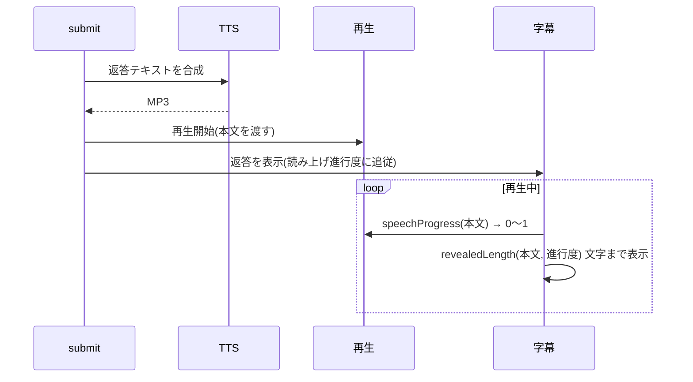

# 音声出力(TTS・字幕・定型音声)

応答を読み上げ、その再生位置に字幕を合わせる。実装は `services/tts.rs`、`services/voice_phrases.rs`、フロントエンドの `lib/api.ts`(再生)、`lib/speech-sync.ts`、`components/Subtitles.tsx`。

## 音声合成(`tts.rs`)

エンジンは設定(`tts_engine`: `google` / `voicevox`、既定 `google`)で選ぶ。`synthesize_speech` は選んだエンジンで合成し、base64 の音声(Google は MP3、VOICEVOX は WAV)を返す。再生側は Web Audio の `decodeAudioData` で形式を自動判別するため、どちらもそのまま再生できる。

### Google Cloud

- Google Cloud Text-to-Speech(REST)。キーは Google Cloud API キー(設定の Voice Link)で、Google STT と共通。
- 言語は本文で判定する(`voice_for`): かな・漢字を含めば日本語(`ja-JP-Neural2-B`)、それ以外は英語(`en-US-Neural2-F`)。
- 入力の上限は 5,000 バイトのため、UTF-8 の文字境界で 4,500 バイトに切って送る。**これを超える長文は先頭部分だけが読み上げられる**。

### VOICEVOX CORE(`voicevox.rs`)

- 端末内で合成する(キー不要・無料。応答テキストも外へ出ない)。
- CORE は同梱しない。設定の「規約に同意して取得」で、公式配布物を GitHub からアプリデータの `voicevox/` へ取得する(約 90MB): CORE(`core/libvoicevox_core.dylib`)、ONNX Runtime(`onnxruntime/`)、OpenJTalk 辞書(`dict/`)、音声モデル `0.vvm`(`models/`。四国めたん・ずんだもん・春日部つむぎ・雨晴はう)。展開はシステムの `tar` / `unzip` を使う。macOS のみ対応。
- 実行時は C API を `libloading` で動的ロードする(`voicevox_onnxruntime_load_once` → OpenJTalk → シンセサイザ → 音声モデル)。初回の合成でロードし、以降は使い回す。取得し直したら破棄して読み直す。
- 声は設定の「声」で選ぶ(`voicevox_style`、既定は 3 = ずんだもん ノーマル)。選択肢は読み込んだモデルのメタ情報から作る。
- 入力は Google と同じ 4,500 バイトに切る(字幕の同期範囲を変えないため)。
- 生成した音声を公開・配布するときは、音声モデルの利用規約に従ったクレジット表記(例: 「VOICEVOX:ずんだもん」)が必要。画面にも注意書きを出している。

### 読み上げの有効条件

`speakReply = 読み上げスイッチ ∧ 選んだエンジンが使える`(Google Cloud はキー登録済み、VOICEVOX は CORE を取得済み。`tts_ready`)。

- 使えないなら読み上げず、字幕だけで応答する(キーも VOICEVOX もなしで字幕のみ使える)。
- 画面の「読み上げ / ミュート」で切り替える。

## 再生(`lib/api.ts`)

- Web Audio API で再生する。操作(送信・マイク操作)の中で `unlockAudio()` を呼んで AudioContext を有効化しておくと、以降の応答は操作なしで自動再生できる。
- 常時待機の応答など、操作なしで再生を始めると中断状態のままになり終了通知が来ないことがある。再生できなければ `playback_error` で失敗させ、再生時間を過ぎたら再生中扱いを解除する(長時間アイドルの後に TTS が再生されなくなる不具合への対処)。
- 再生中は出力波形を `AnalyserNode` で取り、画面のオーブ・波形に使う。
- 再生を始めるとき直前の再生は止める。`waitForSpeechEnd` で再生の終了を待てる(上限 300 秒)。

## 字幕の同期(`speech-sync.ts`)

読み上げの再生位置に合わせて、字幕を先頭から順に表示する。

- `revealedLength`: 読み上げ時間を文字数で按分し、句読点の後の間だけ重みを足して(「。」は 3 文字分、「、」は 1.5 文字分など)ずれを抑える。進行度 1 で全文。
- `spokenLength`: TTS が読む上限(4,500 バイト)までの長さ。上限を超える分は読まれないため、字幕もそこまでを同期の対象にする。
- 字幕のために、音声を作って再生を始めてから返答を表示する。読み上げ前に長い待ち時間が生じるが、字幕と音声のずれを防げる。

## 定型音声(`voice_phrases.rs`)

繰り返し使う短い音声は、事前に 1 度だけ合成して保存し、実行時は TTS へ送らず再生する。常時待機中に課金が発生しないようにするのが主な目的。

| id | 文言 | 用途 |
| --- | --- | --- |
| `wake_ack` | 用件は、なんでしょうか | 起動ワードだけが言われたときの応答([wake-standby.md](wake-standby.md)) |
| `switch_confirm` | 新しい会話を始めてもよいですか | 会話の切り替えの確認([conversation-session.md](conversation-session.md)) |

- 設定の「定型音声を作成」で、未作成の音声だけを選んだエンジンで合成してアプリデータの `voice/` に保存する。
- ファイル名は `<id>-<FNV-1a ハッシュ>.<mp3 または wav>`。ハッシュは「声の名前 + 文言」から作る(VOICEVOX は `voicevox-<スタイルID>`)ため、文言・声・エンジンが変わると別名になり、古い音声は未作成として扱われる。エンジンや声を変えたら作り直す。
- 書き込み途中のファイルを作成済みと見なさないよう、一時ファイル経由でリネームする。途中で失敗しても作成済みの分は残る。
- 未作成の間は、定型音声を再生せずに待つ(無音)。新しい定型音声を足すときは `PHRASES` に追加する。
