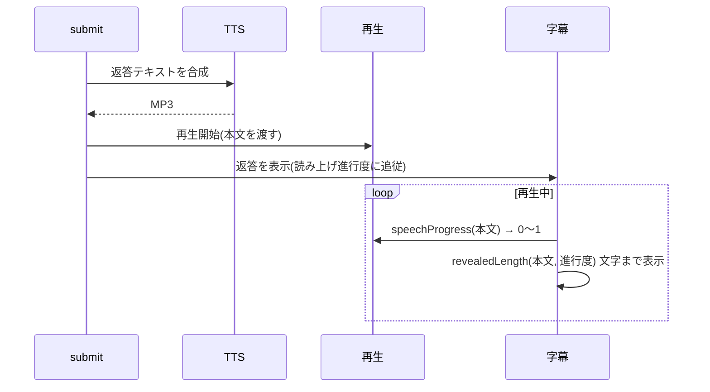

# 音声出力(TTS・字幕・定型音声)

応答を読み上げ、その再生位置に字幕を合わせる。実装は `services/tts.rs`、`services/voice_phrases.rs`、フロントエンドの `lib/api.ts`(再生)、`lib/speech-sync.ts`、`components/Subtitles.tsx`。

## 音声合成(`tts.rs`)

- Google Cloud Text-to-Speech(REST)。キーは Google Cloud API キー(設定の Voice Link)で、Google STT と共通。
- 言語は本文で判定する(`voice_for`): かな・漢字を含めば日本語(`ja-JP-Neural2-B`)、それ以外は英語(`en-US-Neural2-F`)。
- 入力の上限は 5,000 バイトのため、UTF-8 の文字境界で 4,500 バイトに切って送る。**これを超える長文は先頭部分だけが読み上げられる**。
- 音声は base64 の MP3 で返す。

### 読み上げの有効条件

`speakReply = 読み上げスイッチ ∧ Google Cloud キー登録済み`。

- キーが未登録なら読み上げず、字幕だけで応答する(Voice Link のキーなしで字幕のみ使える)。
- 画面の「読み上げ / ミュート」で切り替える。

## 再生(`lib/api.ts`)

- Web Audio API で再生する。操作(送信・マイク操作)の中で `unlockAudio()` を呼んで AudioContext を有効化しておくと、以降の応答は操作なしで自動再生できる。
- 常時待機の応答など、操作なしで再生を始めると中断状態のままになり終了通知が来ないことがある。再生できなければ `playback_error` で失敗させ、再生時間を過ぎたら再生中扱いを解除する(長時間アイドルの後に TTS が再生されなくなる不具合への対処)。
- 再生中は出力波形を `AnalyserNode` で取り、画面のオーブ・波形に使う。
- 再生を始めるとき直前の再生は止める。`waitForSpeechEnd` で再生の終了を待てる(上限 300 秒)。

## 字幕の同期(`speech-sync.ts`)

読み上げの再生位置に合わせて、字幕を先頭から順に表示する。

- `revealedLength`: 読み上げ時間を文字数で按分し、句読点の後の間だけ重みを足して(「。」は 3 文字分、「、」は 1.5 文字分など)ずれを抑える。進行度 1 で全文。
- `spokenLength`: TTS が読む上限(4,500 バイト)までの長さ。上限を超える分は読まれないため、字幕もそこまでを同期の対象にする。
- 字幕のために、音声を作って再生を始めてから返答を表示する。読み上げ前に長い待ち時間が生じるが、字幕と音声のずれを防げる。

## 定型音声(`voice_phrases.rs`)

繰り返し使う短い音声は、事前に 1 度だけ合成して保存し、実行時は TTS へ送らず再生する。常時待機中に課金が発生しないようにするのが主な目的。

| id | 文言 | 用途 |
| --- | --- | --- |
| `wake_ack` | 用件は、なんでしょうか | 起動ワードだけが言われたときの応答([wake-standby.md](wake-standby.md)) |
| `switch_confirm` | 新しい会話を始めてもよいですか | 会話の切り替えの確認([conversation-session.md](conversation-session.md)) |

- 設定の「定型音声を作成」で、未作成の音声だけを Google Cloud TTS で合成してアプリデータの `voice/` に保存する。
- ファイル名は `<id>-<FNV-1a ハッシュ>.mp3`。ハッシュは「声の名前 + 文言」から作るため、文言や声が変わると別名になり、古い音声は未作成として扱われる。
- 書き込み途中のファイルを作成済みと見なさないよう、一時ファイル経由でリネームする。途中で失敗しても作成済みの分は残る。
- 未作成の間は、定型音声を再生せずに待つ(無音)。新しい定型音声を足すときは `PHRASES` に追加する。
