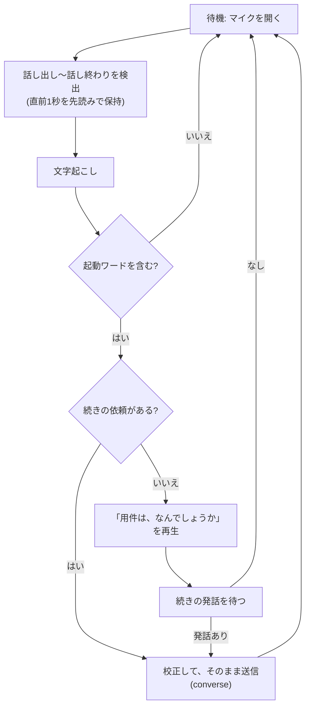

# 常時音声待機(起動ワード)

設定で起動ワードを登録すると、対話画面を開いている間マイクを開いたままにし、**起動ワードを含む発話があったときだけ**依頼を受け付ける。実装は `services/wake.rs`、`commands/voice.rs`(`stop_recording_and_check_wake`)、`components/Chat.tsx`(`standbyLoop` / `handleWake`)。

## 設計方針

- **LLM へ送るのは起動ワードを含む発話だけ**。判定は文字起こしの直後、校正より前に行う。含まない発話は校正にも送信にも回さない(待機中の LLM 料金を抑える)。
- **TTS も使わない**。起動ワードへの応答は、事前に作成した定型音声(`wake_ack`)を再生する([voice-output.md](voice-output.md))。
- 起動ワードが無ければ待機は有効にならない(保存時に自動でオフにする)。
- 音声認識に Google / Aqua を選んでいる場合、待機中の発話ごとに認識の課金がかかる。ローカル Whisper なら課金はない。

## 流れ

- 「タチコマ、今日の予定は」のように続けて話せば、そのまま依頼として送信する。起動ワードだけなら応答して用件を待つ。用件が聞き取れなければ、もう一度呼びかけるよう案内する。
- 校正するのは起動ワードに続く依頼の部分だけ。

## 起動ワードの検出(`wake::detect`)

表記ゆれを揃えて部分一致で調べる。

| 揃える対象 | 内容 |
| --- | --- |
| 全角英数 → 半角 | `ＡＢＣ` → `abc` |
| カタカナ → ひらがな | `タチコマ` → `たちこま` |
| 英字 | 小文字へ |
| 除去 | 句読点・空白・長音符 `ー` など(英数字以外) |

- 複数のワードが含まれる場合は、最初に現れたもの(同じ位置なら長い方)を使い、**そのワードより後ろの文章**を依頼の続きとして返す。続きがなければ空文字。
- 登録できるのは最大 10 語。揃えた後の長さが 2〜20 文字の語だけが有効で、短すぎる語(普通の会話で誤検知する)・長すぎる語・表記ゆれを除いて重複する語は保存時に捨てる(`sanitize_words`)。

## 待機ループ(`standbyLoop`)

- 次の間は録音を開かない(`blocked`): 処理中、モデルのダウンロード待ち、承認待ち、会話中(`converse`)、読み上げ中。自分の応答の音声を拾って誤作動するのを防ぐ。
- 読み上げや処理が終わってから 600ms 空けて再開する(残響対策)。
- 周囲の音量の基準(最小値)は 10 秒ごとに取り直し、環境音の変化に追従する。
- 話し出すまでは、直前の 1 秒だけを残す(出だしが欠けないようにする。無音を溜めない)。
- 短い・無音・認識結果なし(`too_short` / `no_audio` / `mic_too_quiet`)は待機中によくあるので黙って聞き直す。マイクに信号が無い(`mic_no_signal`)ときは繰り返さずエラーを出して止める。
- 手動の録音が始まったら、待機は譲る(`lost`)。

## Whisper への語彙ヒント

起動ワードは、ローカル Whisper の語彙ヒントにも渡す([voice-input.md](voice-input.md))。固有の呼び名が誤認識されにくくなる。

## 設定

| 項目 | キー | 備考 |
| --- | --- | --- |
| 有効 / 無効 | `wake_enabled` | 起動ワードが空なら常に無効 |
| 起動ワード | `wake_words` | JSON 配列。最大 10 語 |
| 定型音声 | — | 設定の「定型音声を作成」で作成。未作成なら無音で待つ |
